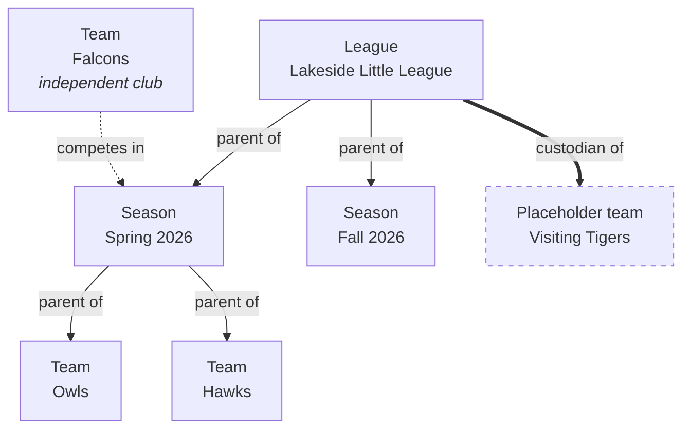
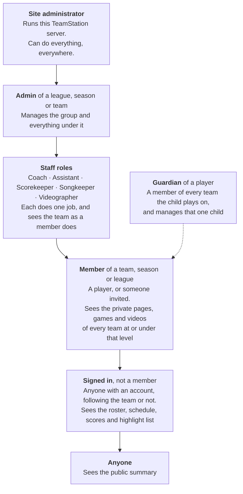
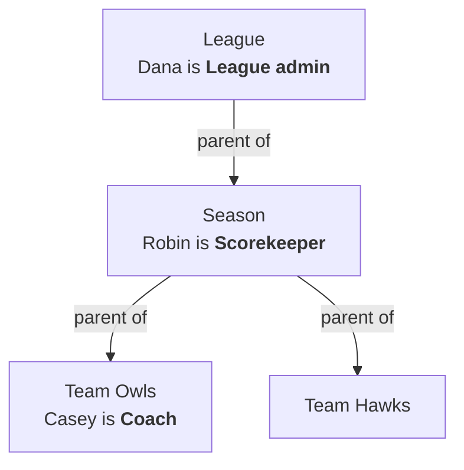
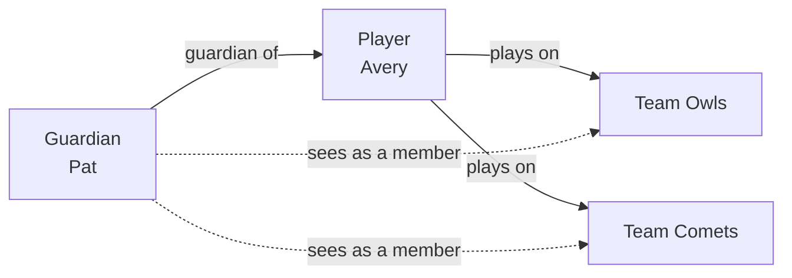
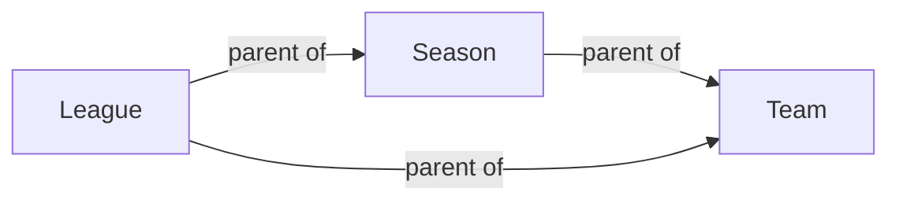
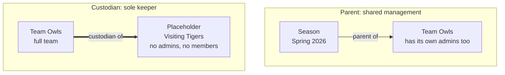
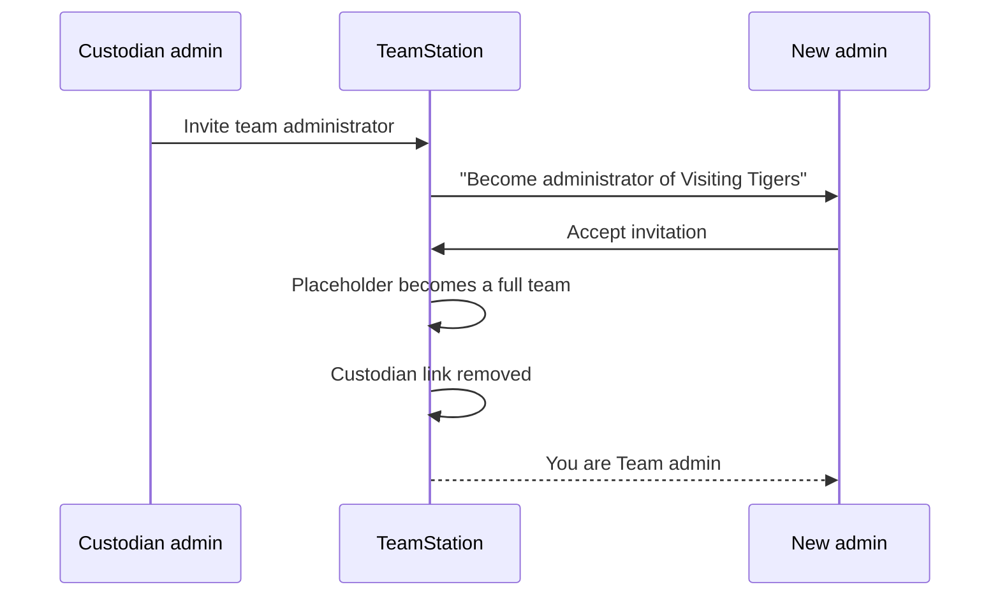
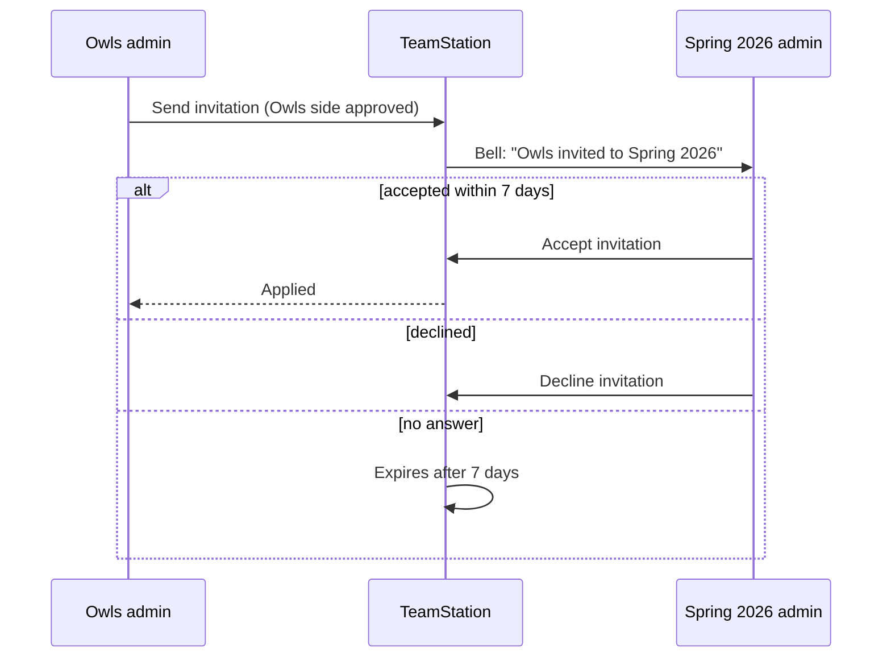

# Who can do what in TeamStation

This guide explains how access works in TeamStation:

- the kinds of groups and how they connect
- the people in them and what each person may do
- guardians, who look after one player wherever that player plays
- people who are signed in but not members, who see a team's page with the members' parts held back
- the difference between a group's **parent** and a placeholder team's **custodian**

It describes what the app does. The last section, [Notes for developers](#notes-for-developers), points at the code and lists the places where it differs from what you might expect.

**Contents**

1. [Leagues, seasons and teams](#1-leagues-seasons-and-teams)
2. [The access ladder](#2-the-access-ladder)
3. [Admins and the five staff roles](#3-admins-and-the-five-staff-roles)
4. [Members: players and spectators](#4-members-players-and-spectators)
5. [Guardians](#5-guardians)
6. [Following and the non-member view](#6-following-and-the-non-member-view)
7. [Parents: sharing management](#7-parents-sharing-management)
8. [Competing in a season is not having a parent](#8-competing-in-a-season-is-not-having-a-parent)
9. [Placeholder teams and their custodians](#9-placeholder-teams-and-their-custodians)
10. [Invitations and approvals](#10-invitations-and-approvals)
11. [Who approves a game](#11-who-approves-a-game)
12. [Safety rules](#12-safety-rules)
13. [The team roster](#13-the-team-roster)
14. [Words that mean two things](#14-words-that-mean-two-things)
15. [Quick answers](#15-quick-answers)
16. [Notes for developers](#notes-for-developers)

---

## 1. Leagues, seasons and teams

TeamStation has three kinds of **group**:

| Group      | What it is                                            | Example                |
| ---------- | ----------------------------------------------------- | ---------------------- |
| **League** | An organization that runs seasons year after year.    | Lakeside Little League |
| **Season** | One competition with dates, a schedule and standings. | Lakeside Spring 2026   |
| **Team**   | The people who play together.                         | Owls                   |

Any group can stand alone. A team can exist without a season, and a season without a league. Groups connect in two ways that sound alike but do very different things:

- **Parent:** the parent's admins and staff also manage the child. This is about **who is in charge**.
- **Competes in:** the team plays in the season's schedule and standings. This is about **who plays whom**, and gives no one any management rights.

A third kind of team, the **placeholder team**, has no admins of its own. It is kept by a **custodian** (see [section 9](#9-placeholder-teams-and-their-custodians)).

In this picture:

- The league's admins manage both seasons, the Owls and the Hawks.
- The Falcons play in Spring 2026 but keep their own management.
- The Visiting Tigers have no admins of their own. The league keeps them.

---

## 2. The access ladder

From most access to least:

A **guardian** sits beside the ladder rather than on it. Through their child they see a team as a member does, and for that one child they can do some of what a coach and a songkeeper do. See [section 5](#5-guardians).

What each level can do. Staff and admins also see everything a member sees. "Child" means the guardian can do it for their own child only.

|                                                                                                 | Site admin | Admin | Coach or Assistant | Scorekeeper | Songkeeper | Videographer | Guardian | Member | Signed in | Anyone |
| ----------------------------------------------------------------------------------------------- | :--------: | :---: | :----------------: | :---------: | :--------: | :----------: | :------: | :----: | :-------: | :----: |
| See the public summary: location, staff, schedule, results                                      |     ✓      |   ✓   |         ✓          |      ✓      |     ✓      |      ✓       |    ✓     |   ✓    |     ✓     |   ✓    |
| Have the group on their Home screen                                                             |     ✓      |   ✓   |         ✓          |      ✓      |     ✓      |      ✓       |    ✓     |   ✓    |  follow   |        |
| See a team's roster names, schedule thumbnails, scores, line scores and highlight list          |     ✓      |   ✓   |         ✓          |      ✓      |     ✓      |      ✓       |    ✓     |   ✓    |     ✓     |        |
| See people's photos, open player pages, watch videos, see batting, pitching and box scores      |     ✓      |   ✓   |         ✓          |      ✓      |     ✓      |      ✓       |    ✓     |   ✓    |           |        |
| Edit players' names, jerseys, positions, bats and throws                                        |     ✓      |   ✓   |         ✓          |      ✓      |            |              |  child   |        |           |        |
| See players' full names                                                                         |     ✓      |   ✓   |         ✓          |      ✓      |            |              |  child   |        |           |        |
| Set walk-up songs                                                                               |     ✓      |   ✓   |                    |      ✓      |     ✓      |              |  child   |        |           |        |
| DJ a game                                                                                       |     ✓      |   ✓   |                    |      ✓      |     ✓      |              |          |        |           |        |
| Score games                                                                                     |     ✓      |   ✓   |                    |      ✓      |            |              |          |        |           |        |
| Film and stream games                                                                           |     ✓      |   ✓   |                    |             |            |      ✓       |          |        |           |        |
| Invite a player's guardian, approve a request to be one (staff: only while the player has none) |     ✓      |   ✓   |         ✓          |             |            |              |  child   |        |           |        |
| Add and remove people, give and take away roles (Coach or Assistant: every role but Admin)      |     ✓      |   ✓   |         ✓          |             |            |              |          |        |           |        |
| Leave a group, or step down from one of your roles                                              |     ✓      |   ✓   |         ✓          |      ✓      |     ✓      |      ✓       |    ✓     |   ✓    |           |        |
| Create seasons, teams, placeholder teams                                                        |     ✓      |   ✓   |                    |             |            |              |          |        |           |        |
| Schedule and approve games (Scorekeeper: only swap home and away)                               |     ✓      |   ✓   |                    |    swap     |            |              |          |        |           |        |
| Add or break parent links                                                                       |     ✓      |   ✓   |                    |             |            |              |          |        |           |        |
| Manage site admins, suspend accounts                                                            |     ✓      |       |                    |             |            |              |          |        |           |        |

Notes on the table:

- **Full names.** Everyone else sees the public name: a first name and last initial, such as "Avery S", unless a league, season or team has chosen another format (see Player name privacy). The public format never takes the stored full name away from the people below. The full name is visible only in the name editor, and in the player's **Settings** and the scoring roster editor opened from a team, to:
  - site admins
  - admins, coaches, assistants and scorekeepers of a team the player plays on
  - the player's guardians
  - the player themselves

  A songkeeper or videographer holds a role on the team but reads short names like everyone else.

- **Scorekeepers keep the roster.** A scorekeeper may be the only person maintaining a team's roster, so they edit its players' names, jerseys, positions, bats and throws and see their full names, as a coach does. That is the whole of it: inviting guardians and managing people and roles stay with admins, coaches and assistants.

- **Guardians decide who else becomes one.** An admin, coach or assistant of a team the player plays on invites or approves the player's **first** guardian only. Once the player has a guardian, only their guardians and the player say who else becomes one. See [section 5](#5-guardians).

- **Signed in** means anyone with an account who isn't a member of the team, whether they follow it or not. They have it on Home only if they follow it. A season or league page is the same public summary for them as for anyone else. See [section 6](#6-following-and-the-non-member-view).
- **One kind of member at every level.** A member of a season is a member of every team the season is parent of, and a member of a league is a member of every team in the league and its seasons, including ones added later. Membership flows down parent links as roles do. See [section 4](#4-members-players-and-spectators).
- **Staff hold roles, not membership.** Holding any role on a team lets you see that team as a member would.
- **Home** lists, from the top: **Live now**, **Recent game**, **Your Players** (the players a person is a guardian of, left out when there are none), **Your teams**, **Seasons** and **Your leagues**. Each section lists the groups the person can see, then the ones they follow. Anyone signed in who has set up their name and photo can create a league, season or team, and becomes its first admin. Each section's header has a **Create** pill for its kind. A kind the person has nothing in has no section; it gets a large **Create** card instead, at the bottom after Your leagues. Someone with nothing at all sees all three cards at the top.

---

## 3. Admins and the five staff roles

### Admin

An **admin** ("Team admin", "Season admin", "League admin" in the app) can:

- add people to the group and remove them
- change what everybody in the group is, Admin included
- create things inside the group
- schedule and approve games
- link the group to a parent, or unlink it

An admin also holds all five staff roles automatically. In the roles sheet that **Add somebody** uses to choose what to give, the role switches are locked on with the caption **"Admins can do all of this"**.

Whoever creates a group becomes its first admin.

### The five staff roles

Each role does one job. An admin can give any combination of them to anyone.

| Role             | What it lets you do (app wording)                                                                                |
| ---------------- | ---------------------------------------------------------------------------------------------------------------- |
| **Coach**        | "Edits the players' jerseys, positions, bats and throws in ‹group›, and sees their full names."                  |
| **Assistant**    | "Same as a coach: edits the players' jerseys, positions, bats and throws in ‹group›, and sees their full names." |
| **Scorekeeper**  | "Scores the games of ‹group›, sets walk-up songs and DJs them."                                                  |
| **Songkeeper**   | "Sets walk-up songs and DJs the games of ‹group›."                                                               |
| **Videographer** | "Films and streams the games of ‹group›."                                                                        |

Two roles include another:

- **Assistant** can do everything a coach can, everywhere a coach can. It is its own role so that the roster and the person profile can say "Assistant".
- **Scorekeeper** holds everything a songkeeper does. In the roles sheet, Songkeeper is locked on with the caption **"Scorekeepers can do this"** while Scorekeeper is on. Saving keeps only the switches actually set, so a scorekeeper is listed as Scorekeeper alone. Songkeeper does not include Scorekeeper.

A scorekeeper also keeps the roster: like a coach, they edit players' names, jerseys, positions, bats and throws and see their full names, because a scorekeeper may be the only person maintaining it. They do no other coaching.

A coach and an assistant also invite a player's guardian and approve requests to be one, while the player has no guardian yet ([section 5](#5-guardians)).

A coach and an assistant also manage the group's people: from its people list they open anybody's profile and add or remove every role there, and membership, **except Admin**, which only an admin gives or takes away. Other roles are **not** admin: a scorekeeper, songkeeper or videographer manages nobody.

### Roles flow downhill

A role given at one level applies to everything **under** it through parent links, never above it:

- a league admin is an admin of every season and team in the league
- a season's scorekeeper can score games for every team the season is parent of

|                                  | League |   Season    |    Owls     |    Hawks    |
| -------------------------------- | :----: | :---------: | :---------: | :---------: |
| Dana, League admin               | admin  |    admin    |    admin    |    admin    |
| Robin, Scorekeeper on the season |   —    | scorekeeper | scorekeeper | scorekeeper |
| Casey, Coach on the Owls         |   —    |      —      |    coach    |      —      |

On a person's profile, roles given at a level above show in that level's own section, for reading only. To take one away, change it at the level it came from. On the team roster, people who get their place from a season or league carry a pill such as **"Season scorekeeper"** ([section 13](#13-the-team-roster)).

### Where to manage people

| What                                                                                     | Where                                                                              |
| ---------------------------------------------------------------------------------------- | ---------------------------------------------------------------------------------- |
| Somebody already on the people list: their roles and membership here                     | The team's **Team** tab, or the season's or league's **People** tab → tap a person |
| Add somebody by email, invitations still waiting, accounts with no address, invite links | Gear → **Settings** (admins)                                                       |

Admins, coaches and assistants of a level can tap every row of its people list: a player opens the player's page, anybody else their **person profile**. Everybody else can tap only players, as before.

The person profile shows, at the top, their photo, their name (the full name, for the admins, coaches and assistants who open it) and the team, season or league it was opened from, such as **"Team · Owls"**. Then:

- **Parent/Guardian of**: one row per child they guard who plays there (on that team; on any team of the season; anywhere in the league), opening the child's page.
- A section of roles per level. From a team: **Team roles**, **Season roles** (one section for every season the team is in) and **League roles**. From a season: Season and League. From a league: League.
- Each section has a row for Admin, Coach, Assistant, Scorekeeper, Songkeeper, Videographer, Member and Follower. On the level the profile was opened from, each role has a switch: green with the thumb to the right for a role they hold, red with it to the left for one they lack. Flipping it takes effect at once. The Admin row has a switch only for an admin, roles only for somebody who can sign in, and **Follower** never has one: following is the person's own. Switching off **Member** takes them out of the level, every role there with it. The levels above are for reading, whoever is looking.

A player who can sign in can hold team roles too. On the player's page opened from a team, its admins, coaches and assistants find the player's **Team roles** near the bottom of **Settings**, with the same rows, except that Member reads **Player** with no switch: taking a role away and taking a player off the roster are separate.

Below them, at the very bottom of **Settings**, an admin of the team (an owner's or manager's membership counts) finds a red **Remove from ‹team›**, for any player, whether or not they can sign in. After a confirmation ("‹player› leaves ‹team›: off the roster, and every role they hold on it.") it takes them off the team and every team role with it, then returns to the roster and says so. Coaches and assistants don't see it. Settings' **No address on file** list still removes people who can't sign in.

---

## 4. Members: players and spectators

A **member** can see a group's private content but has no management role. A member is the same at every level: a team's own member, a season's and a league's all see a team in the same way.

### Team members

A team member is one of three things:

| Kind                | How they got here                                                              | Shows on the roster under                                                                   |
| ------------------- | ------------------------------------------------------------------------------ | ------------------------------------------------------------------------------------------- |
| **Owner / manager** | Created the team, or was made its admin                                        | **Admins**                                                                                  |
| **Player**          | Added as a player                                                              | **Players**, unless they also hold a role                                                   |
| **Member**          | Accepted an invitation or used an invite link, or was added by a roster import | **Family members** if they are a guardian of a player on the team, otherwise **Spectators** |

A team member sees:

- the team's private page and roster, with short names and photos
- its games, videos, plays and stats
- the pages of people who have played for the team

### Season and league members

You can belong to a season or a league without being on any team. This is for people like a league photographer or a grandparent who wants every game. They are the same kind of member a team has, one level up:

- A **season member** is a member of every team the season is parent of, and sees every game of the season.
- A **league member** is a member of every team in the league and in its seasons, and sees every game of every season in the league, including seasons and teams created later.
- They see those teams as the teams' own members do: the private page, the roster with photos, player pages, games, videos and stats.
- Like roles, membership flows down parent links only. A team that only competes in the season is not reached ([section 8](#8-competing-in-a-season-is-not-having-a-parent)).
- On each of those teams' rosters they are listed under **Spectators**, with a pill: **"Season spectator"** or **"League spectator"** ([section 13](#13-the-team-roster)).
- Membership is not a role. A member edits nothing, and reads short names like everyone else.

### How people become members

Nobody accepts anything to be added. Adding someone as a member, or as Admin, Coach, Assistant, Scorekeeper, Songkeeper or Videographer, takes effect at once, at a team, a season or a league: the membership of that level, and the role.

- **Add by email.** An admin uses **Add somebody** in Settings, optionally with roles. An address an account has verified adds that account at once; they get a notification in the bell's inbox ("Dana Lee added you as Coach of Owls") and an email saying the same. An address nobody has verified yet gets an invitation ("Invitations last seven days"), which applies itself the moment somebody signs up or signs in with that address, or adds it to their account and verifies it.
- **From the people list.** An admin, coach or assistant taps somebody on the level's people list (a season member on a team's roster, a follower, a guardian) and adds them as **Member** or a role on their profile. They are told the same way, and mailed when they were not in the level before.
- **Invite link.** An admin uses **Invite people**: "Anybody with the link can watch…". A link makes whoever uses it a plain member of that level, team, season or league, and never lowers access someone already has.
- **Added as a player** by a team admin.

There is no "ask to join" button. Joining always starts with an admin, coach or assistant. The one thing anybody can ask for is to be a player's guardian ([section 5](#5-guardians)), and that gives access to the child's teams without making the guardian a member of them.

### Leaving

Anybody can leave a team, season or league, or step down from one of their roles there. The notification that they were added has a **Leave** button. Leaving takes away the membership of that level and every role held there; a membership or role given at a level above stays, and is left at that level. The last direct admin of a group can't leave it ([section 12](#12-safety-rules)).

---

## 5. Guardians

A **guardian** is an adult linked to a specific player, usually a parent. The link is between two _people_, not between a person and a team.

### Access follows the child

A guardian sees **every team their child plays on now**, as a member does: the private page, the roster with photos, games, videos and stats. Nothing is written down when this happens. It is read from the child's teams each time:

- When the child joins a team, the guardian can see it at once.
- When the child leaves a team, the guardian loses it, unless the guardian is a member of that team in their own right (for example, a roster import added them as a member, or they are a member of its season).

The child's own page is always open to their guardian, including the teams the child has left: the Videos, Stats and Teams tabs cover the child's whole career.

### Managing their child

For their own child, and no other player, a guardian can:

- see the child's full name
- change the child's jersey number and positions on any team the child plays on
- change how the child bats and throws
- set or remove the child's walk-up song on any team the child plays on

A guardian can't:

- change anything about another player
- DJ a game, score it or film it
- invite or remove people, or see anything about the team that a member can't see

In the app, players a person guards appear under **Your Players** on Home, above **Your teams**. Where the player's page was opened from decides what its **Settings** tab edits:

| Opened from              | Stats and Videos start at | Settings edits                   |
| ------------------------ | ------------------------- | -------------------------------- |
| **Your Players** on Home | The whole career          | Bats and throws                  |
| A team's roster          | That team                 | That team's jersey and positions |

Opened from a team by one of its admins, coaches, assistants or scorekeepers, Settings also edits the player's first and last name.

A guardian also sees the **Walk-up** tab when the page is opened from a team.

### Becoming a guardian

Who decides depends on whether the player has a guardian yet. A player **has a guardian** when any account that can sign in, is not suspended and is not closed into another holds a guardian link to them. A parent a roster import added with no email address can't sign in. They are listed under Family members, but they don't count here: the team's staff keep the say until a guardian who can sign in is added.

- **No guardian yet:** an admin, coach or assistant of a team the player plays on now speaks for the player. They can invite the first guardian, and approve a request to be one.
- **Once there is a guardian:** only the player's guardians, and the player, say who else becomes one. The team's staff can no longer invite a guardian or approve a request. A team that sends an invitation now gets "‹player› has a guardian already. Ask them to invite another guardian."

A site admin can do all of it, whether or not the player has a guardian. Whether the player has a guardian is read when an invitation is sent and again when anyone answers it, not only when a request was made.

There are four ways.

**1. A team invites the first guardian.** While the player has no guardian, an admin, coach or assistant of a team opens one of the team's players from the roster and uses **Settings → Invite a guardian**, with an email address. TeamStation emails that address ("‹coach› from ‹team› invited you to be ‹player›'s guardian on TeamStation"). The invited person signs in with an account that has verified that address and accepts from the bell's inbox. Their acceptance is the only one needed. If the player gets a guardian before the invitation is accepted, accepting it is refused with the same "has a guardian already" message, and the team can withdraw it.

**2. A guardian invites another.** A guardian of the player uses **Settings → Invite a guardian** on the player's page, opened from a team or from **Your Players** on Home. The invitation goes out in the guardian's own name, from no team ("‹guardian› invited you to be ‹player›'s guardian on TeamStation"), and the invited person accepts it the same way. It needs the sender to still be a guardian when it is accepted. It counts toward the sender's five waiting (below). Anyone else who sends one without a team gets "Only a guardian of the player can invite a guardian without a team".

**3. Someone asks to be a guardian.** A signed-in person who can see one of the player's teams, and has no say over the player already, taps **Request to be a guardian** under the player's name. **One** approval is enough, from any of:

- the player, if their account can sign in,
- any guardian of the player, or
- only while the player has no guardian, an admin, coach or assistant of a team the player plays on now, including one who holds the role through a season or league.

The approval must come from someone other than the requester. A coach who asks to be the guardian of one of their own players waits for the player or for someone else who can approve, just as anyone else does.

The request appears in the bell's inbox of the player and of each of the player's guardians, or, while the player has none, of every admin, coach and assistant of the player's teams, except the requester. It reads "‹name› asks to be ‹player›'s guardian", with "Approving lets them see ‹player›'s teams and manage ‹player›'s details." If the player gets a guardian while a request is waiting, it leaves the staff's inboxes and goes to that guardian. A scorekeeper, songkeeper or videographer can't approve.

**4. A roster import.** A team admin's roster tool can import adults with the players they look after. A guardian link is made only to a player who had no guardian (one who can sign in, as above) when that import began, so every parent one import names for a new player is linked. It is never made to the account of the person running the import. Links that are refused are counted as `guardiansRefused` in the import's answer. A site admin's import is held to neither rule. Imported guardians are also added to the team as members, so they keep that team even if the child leaves it.

```mermaid
sequenceDiagram
  participant R as Requester
  participant TS as TeamStation
  participant A as Player, a guardian, or (no guardian yet) a team coach
  R->>TS: Request to be a guardian
  TS->>A: Bell: "Pat asks to be Avery S's guardian"
  alt approved within 7 days
    A->>TS: Accept
    TS-->>R: Guardian of Avery S
  else declined
    A->>TS: Decline
  else no answer
    TS->>TS: Expires after 7 days
  end
```

### Rules and limits

- **Nobody is their own guardian.** "A player can't be their own guardian." This includes an invitation sent to an address the player holds.
- **Nobody is asked twice.** Someone who already guards the player can't ask to be their guardian again: "You are already ‹player›'s guardian." Nobody can invite them either: "‹name› is already ‹player›'s guardian."
- **The same request is sent once.** Asking again for the same player while a request is still waiting answers with that request, so the button reads **Guardian request sent** again even after a reload. Nobody is told twice, and it counts once toward the limit below. A team, or a guardian, inviting the same account or address for the same player while its invitation is waiting gets that invitation back, and nothing is mailed again.
- **Nobody approves themselves.** A requester's own approval never counts for the player. A coach or a guardian can't invite themselves, by account or by any address they hold: "You can't invite yourself to be a guardian." If the sender later verifies the address they invited, they still can't accept it.
- **Seven days.** Guardian invitations and requests expire like every other invitation. They are never resent: "A guardian request is not resent. Send a new one."
- **Withdrawing.** A requester can withdraw their own request, and a guardian their own invitation. An admin, coach or assistant of the team that sent an invitation can withdraw it, even once the player has a guardian.
- **At most five waiting.** A person with five requests and guardian's invitations still waiting gets "You have 5 guardian requests waiting. Wait for an answer before asking again."
- **Three declines, then a week.** On a person's third declined request they can't ask again for seven days: "Three guardian requests were declined. You can ask again on ‹date›." After the week, the count starts again.
- The limits count only what a person sends without a team: their requests and, as a guardian, their invitations. Invitations a coach sends from a team never count toward the coach's limits. A declined invitation never counts toward the three declines, and the week's block doesn't stop a guardian inviting. Expired and withdrawn ones count toward neither limit.

### The risk that remains

A child with **no guardian** can be claimed by the admins, coaches and assistants of **any** team the child is on. That includes a team a stranger created and added the child to by the child's external id from another system: its admin can invite a guardian (themselves at a second address, say), approve a request to be one, or import one. The first guardian then controls who else becomes one, and a real parent who arrives later has to ask that guardian.

Nothing in the app removes a guardian link. A site admin who finds a wrong one can suspend that account (a suspended account is nobody's guardian, and can't sign in), or remove the link (`user_links` row) directly in the database. There is no admin screen or route for it.

---

## 6. Following and the non-member view

**Follow** is a bookmark. Anyone signed in can follow any league, season or team. The group then appears on their Home screen after their own groups. Following gives no access of its own.

Anyone **signed in** who isn't a member of a team gets the **non-member view** of it, whether they follow it or not, and however they reach it: from Search, from Home, from a game or from a link. It is the team's own page, the same one members see, with the members' parts held back:

| Part of the team | A non-member sees                                                                                                                                                           |
| ---------------- | --------------------------------------------------------------------------------------------------------------------------------------------------------------------------- |
| Roster           | Every name, in every section, followers included, with initials and no photos. Family members are listed without whom they are a guardian of. Rows don't open player pages. |
| Stats            | The **Season performance** card. In place of batting and pitching: "You need to be a member of one of the teams to see this."                                               |
| Schedule         | Every game, with its thumbnail and video count. Each game opens.                                                                                                            |
| Standings        | The team's place in its season.                                                                                                                                             |
| Videos tab       | "You need to be a member of one of the teams to see this."                                                                                                                  |

And on any game, for anyone signed in who is a member of neither team:

| Part of the game | A non-member sees                                                                                                                                                                                                                             |
| ---------------- | --------------------------------------------------------------------------------------------------------------------------------------------------------------------------------------------------------------------------------------------- |
| Score card       | The score and both teams' records. No per-team summary (hits, walks, strikeouts, home runs).                                                                                                                                                  |
| Line score       | Runs by inning and the run total.                                                                                                                                                                                                             |
| Videos tab       | No player. In its place: "You need to be a member of one of the teams to watch this game's videos." Below it, the highlights with their thumbnails. Tapping one plays nothing, and the same message appears again under the highlight tapped. |
| Box score        | The line score, then "You need to be a member of one of these teams to see individual player stats."                                                                                                                                          |

Each message is in the page's normal text colour, on the page itself. Nothing is drawn in a player's black box.

A game nothing was recorded of shows **"No videos."** in place of the player, to everyone.

Each thumbnail's link opens only its own frame. Changing the second or the video in it is refused, so the thumbnails can't be used to pull other frames of a game a non-member can't play. This holds for members' thumbnails too.

Signed-out visitors see the public summary of a team: location, parents, staff, schedule and results. A member never gets the non-member view, whatever they follow, and that includes a member of the team's parent season or league, and members don't see the **Follow** button, because their groups are already on Home. Season and league pages don't change: someone who isn't in one sees its public summary, followed or not.

---

## 7. Parents: sharing management

A **parent link** says "this group's admins and staff also run that group." It is the only way roles flow from one group to another.

### Which links are allowed

| Child            | Possible parents        | How many                                                                                                                                                                                          |
| ---------------- | ----------------------- | ------------------------------------------------------------------------------------------------------------------------------------------------------------------------------------------------- |
| League           | —                       | A league never has a parent.                                                                                                                                                                      |
| Season           | A league                | At most **one**. To move a season, break the old link first.                                                                                                                                      |
| Team             | A league and/or seasons | At most **one league**. Any number of seasons, as long as they're **all in that league** (for example, a Regular Season and its Playoffs). A team with no league can have only one parent season. |
| Placeholder team | —                       | Never has a parent. It has a custodian instead ([section 9](#9-placeholder-teams-and-their-custodians)).                                                                                          |

A team can never be a parent, so links can't form a loop.

### What a parent link changes

- **Adding** a link immediately gives the parent's admins and staff the same roles on the child.
- **Breaking** a link immediately takes those inherited roles away. Roles given directly on the child stay.
- A parent link **never touches** rosters, games, results or which seasons a team competes in. The app says: "Only management permissions change. Competition memberships, rosters, games and results are preserved." The parent's admins and staff do appear on the child team's roster, with a pill naming where their role comes from ([section 13](#13-the-team-roster)).

A few links follow automatically:

- **Season joins a league.** Its teams that had no league join that league too.
- **Team gets a parent season.** If the team has no league, it takes the season's league.
- **Season leaves its league.** The season stops being parent of those of its teams that have a league. The teams keep their league.
- **Team leaves its league.** The team also loses its parent seasons in that league.

The app shows every one of these in a preview before anything is saved.

### Who must agree

| Action                            | Who must approve                                                          |
| --------------------------------- | ------------------------------------------------------------------------- |
| **Add** a parent link             | An admin of the **child** _and_ an admin of the **parent**                |
| **Break** a parent link           | An admin of **either** side. It happens at once, with no invitation.      |
| **Create** a group under a parent | You must already be an admin of the parent. The link is made on creation. |

When the same person can approve all required sides, **Save** applies their
approvals together. The app returns to the connection and shows its details in
a five-second success toast. Otherwise the request goes to the other side's
admins ([section 10](#10-invitations-and-approvals)).

---

## 8. Competing in a season is not having a parent

A team **competes in** a season when it is on that season's schedule and standings. This is called _participation_, or _competition membership_. It is completely separate from management.

|                                                       | **Season is the team's parent**             | **Team competes in the season**                                       |
| ----------------------------------------------------- | ------------------------------------------- | --------------------------------------------------------------------- |
| In the app                                            | "Team this season manages"                  | "Team that competes"                                                  |
| Season admins manage the team?                        | **Yes**                                     | **No.** "The team plays in this season and keeps its own management." |
| Season staff roles reach the team?                    | Yes                                         | No                                                                    |
| Season admins and staff on the team's roster?         | Yes, with a "Season ‹role›" pill            | No                                                                    |
| Season members are members of the team?               | Yes, listed as "Season spectator"           | No                                                                    |
| Team appears in the season's Teams tab and standings? | Yes, once it has games                      | Yes                                                                   |
| Who must agree                                        | Admins of both                              | Admins of both                                                        |
| How to end it                                         | **Break parent relationship** (either side) | **End participation** (either side). Games are kept.                  |

The two are independent. A team can have a parent season and also compete in it, or compete in a season it has no parent link to (the Falcons in [section 1](#1-leagues-seasons-and-teams)).

**Participation grants bounded scheduling consent.** A season's administrators,
whether appointed directly or inherited from a management parent, can schedule
a game without separate approval from either team when **both teams have active
participation in that same season and the game is hosted by that season**.
This grants no roster, role or other team-management permission. Having games in
a season, a management-parent link alone, or an inactive participation does not
qualify. A season coach or assistant without administrator authority does not
receive this permission. Ending participation removes this delegation for future
approvals; already scheduled games and their results remain unchanged.

On the season's Teams tab, teams are grouped by their games, not by their links. **Exhibition** is a property of a game, not of a team. The groups are:

- **Teams:** has a regular game in the season
- **Exhibition Teams:** has exhibition games only
- **Unscheduled:** "These teams are in the season but don't have scheduled games."

---

## 9. Placeholder teams and their custodians

A **placeholder team** is a stand-in for a team that isn't on TeamStation. A typical use is an out-of-town opponent, so their games can be scheduled and scored. It has no admins and no members of its own. Instead, it has exactly one **custodian**: the league, season or team that keeps it. The app shows **"Managed by ‹custodian›"**.

In the app: "A stand-in for a team without its own administrator, kept by ‹name›."

### What the custodian's admins can do

- create the placeholder, from the league or season **Create** sheet, the team's settings, or while setting up a game
- schedule its games, and approve or decline game proposals on its behalf
- invite one real person to take it over (promotion, below)

### What nobody can do while it's a placeholder

- invite members or give anyone roles on it
- join it to a season as a competing team
- give it a parent link

### Custodian vs parent

|                                    | **Parent**                              | **Custodian**                                    |
| ---------------------------------- | --------------------------------------- | ------------------------------------------------ |
| Applies to                         | Seasons and full teams                  | Placeholder teams only                           |
| How many                           | One league, plus seasons in that league | Exactly one                                      |
| Can be a league?                   | Yes                                     | Yes                                              |
| Can be a season?                   | Yes, of a team                          | Yes                                              |
| Can be a team?                     | **No**                                  | **Yes**, a full team (never another placeholder) |
| The child also has its own admins? | Usually, yes                            | **Never**. The custodian is the only management. |
| Roles reach the child              | Admins _and_ staff roles                | Admin rights only, for scheduling and approving  |
| Rights reach further down?         | Yes, keeps flowing downhill             | No, a placeholder has nothing under it           |
| Needs the child's consent?         | Yes, both sides approve                 | No, the custodian creates it                     |
| Ends when                          | Either side breaks the link             | The placeholder is promoted                      |

A league, a season or a full team can each be a custodian. The difference is only whose admins keep the placeholder:

| Custodian  | Who keeps the placeholder                                       | Typical use                          |
| ---------- | --------------------------------------------------------------- | ------------------------------------ |
| **League** | League admins, and anyone who inherits league admin             | Opponents the whole league plays     |
| **Season** | Season admins, including league admins above it                 | An opponent in one season's schedule |
| **Team**   | That team's admins, including season and league admins above it | A team's own exhibition opponent     |

A placeholder can't be the custodian of another placeholder.

### Promotion: when the real team arrives

When the real team arrives, a custodian admin uses **Invite team administrator**. The person invited must have signed in and verified their email. When they accept:

1. The placeholder becomes a full TeamStation team, keeping its name, location and game history.
2. The person who accepted becomes its admin.
3. The custodian link ends, and the custodian's admins lose all rights over it.
4. Games awaiting approval need the new admin's approval again.

---

## 10. Invitations and approvals

Changes affecting more than one group use shared approval records. When the
person submitting can approve every required side, Save applies the change
immediately, returns to its connection or game and shows a detailed five-second
toast; it does not open an invitation notification. Other changes are invitations,
as are granting a guardianship or access for an email address nobody has verified
yet. Adding somebody who has an account, as a member or to any role, applies at
once ([section 4](#how-people-become-members)). Invitations follow the same rules:

- **Two-way.** Every affected side must approve. Sending counts as your side's approval.
- **Any eligible admin can answer** for their team, season or league. "Opening this invitation does not approve it."
- **Seven days.** An invitation expires if it isn't answered. The sender can **withdraw** it, and can **resend** it, except a guardian invitation or request, which is sent anew instead.
- **Current approvals when submitted again.** An authorized sender's available
  approvals are applied to the successor. If none remain outstanding, it returns
  to the connection or game with a five-second confirmation instead of opening
  an approved notification. Someone else's consent is never supplied for them.
- **Approval is checked again at the end.** If your admin rights came from a parent link that has since been broken, your earlier approval no longer counts.
- **Changing a season's dates or time zone** cancels its pending parent and participation invitations, because they named the old dates.

| Invitation                         | Sent by                                                                                   | Approved by                                                                                                                                    | When accepted                                                                                    |
| ---------------------------------- | ----------------------------------------------------------------------------------------- | ---------------------------------------------------------------------------------------------------------------------------------------------- | ------------------------------------------------------------------------------------------------ |
| **Person** (Add somebody)          | Group admin, to an address no account has verified                                        | Nobody: it applies when somebody verifies the address, or accepts it from its link                                                             | They get the access and roles that were offered                                                  |
| **Parent**                         | Admin of the child or parent                                                              | Admins of both                                                                                                                                 | The parent link is made                                                                          |
| **Participation** (Join a season)  | Admin of the team or season                                                               | Admins of both                                                                                                                                 | The team competes in the season                                                                  |
| **Promotion**                      | Custodian admin                                                                           | The invited person                                                                                                                             | The placeholder becomes a full team (see [section 9](#9-placeholder-teams-and-their-custodians)) |
| **Game / game change**             | Admin of a playing team, or of the hosting season                                         | Both teams' admins                                                                                                                             | The game is published or changed (see [section 11](#11-who-approves-a-game))                     |
| **Guardian invitation (team)**     | Admin, coach or assistant of a team the player plays on, while the player has no guardian | The invited person, who can't be the sender                                                                                                    | They become the player's guardian (see [section 5](#5-guardians))                                |
| **Guardian invitation (guardian)** | A guardian of the player, with no team                                                    | The invited person, who can't be the sender, while the sender is still a guardian                                                              | They become another guardian of the player                                                       |
| **Guardian request**               | Anyone signed in who can see one of the player's teams                                    | The player, a guardian of the player, or (while there is none) an admin, coach or assistant of a team the player plays on; never the requester | The requester becomes the player's guardian                                                      |

Everything waiting on you is in the bell's inbox:

- **Pending:** waiting on you ("Needs your approval")
- **Sent:** waiting on others ("Awaiting approval")
- **History:** finished invitations

---

## 11. Who approves a game

A game has two sides: the home team and the away team. It is published when **both** sides have approved. For each side, an approval can come from:

- an admin of that team, directly or through a parent link, or
- for a placeholder team, an admin of its custodian, or
- a direct or inherited admin of the hosting season, when **both proposed teams
  are active participants in that season**. This authority is checked again
  before publication, including current participation and administrator rights.

There is no separate approval from the season. However, placing a new game in a season requires the sender to be an admin of that season.

Create Game and Game Settings both end with **Save**. What Save does depends on what you administer:

| You administer…                                            | What happens                                                                     |
| ---------------------------------------------------------- | -------------------------------------------------------------------------------- |
| Both teams                                                 | Published immediately                                                            |
| One team                                                   | The other team's admins must approve. "An admin of ‹team› must approve changes." |
| Only the season, both teams actively participate in it     | Published immediately when hosted in that season                                 |
| Only the season, either team does not actively participate | Team approvals are required unless you also hold the relevant team authority     |

Until the game is approved, it shows **Pending approval** where the score would be.

Other game rules:

- **Swapping home and away.** A scorekeeper of either team, which every admin of it is, may swap home and away with no approval, from the scoring menu or from Game Settings, where it is the only setting a scorekeeper who administers neither team can change. Before the first pitch only the sides change. Once the game has plays, the swap resets them: the scorer is told how many at-bats and innings will be lost and confirms with **Reset and Swap**, and the game goes back to its lineups at the first pitch. A withdrawn game cannot be swapped.
- **Withdrawing.** Any admin of either team can withdraw their team without approval. The game stays on the schedule as cancelled, with the reason.
- **Changing an opponent you don't administer.** The original game is cancelled, still visible to that opponent, and a new game is proposed.

---

## 12. Safety rules

- **Full names stay with the people who need them.** A player's full name is read only in the name editor and where the roster is kept (a player's Settings and the scoring roster editor, opened from a team), by a site admin, the player, the player's guardians, and the admins, coaches, assistants and scorekeepers of a team the player plays on. Rosters, player pages, box scores and the public staff list carry short names, such as "Avery S", for everyone.
- **A name lives in the person's account, and nowhere else.** Plays, highlights, lineups, default lineups, the scoreboard, the announcer and notifications all read a person's name from their account when they are shown, so a rename, or an account deletion (which renames it "Deleted user"), shows on every one of them at once. Nothing keeps a copy that could go on showing an old name. The one exception is a player typed into a game with no account, whose typed name is all there is of them.
- **A game-only player's name is corrected on their account.** A game-only player (added for one game, who does not sign in) is renamed from the scoring roster editor by whoever may save their side's lineup: that team's head coach, or anyone who may score the game. The correction renames their account, so it shows wherever they appear. A player who signs in keeps their own name, and a deleted account cannot be renamed.
- **Non-members see no faces.** In the non-member view, the roster has no photos and its rows don't open player pages.
- **Every group keeps at least one admin.** "Add another active direct administrator before removing the last one." Only admins given directly on the group count; admins inherited from a parent don't. Placeholder teams are the exception, since they never have admins.
- **New admins must be real, verified accounts.** They must have signed in and verified their email.
- **Leaving.** Anybody can leave a group or step down from one of their roles, an admin as long as another direct admin remains.
- **Admin stays with admins.** Coaches and assistants add and remove every role but Admin; only an admin makes or unmakes one, or takes an admin out of a group.
- **Removing someone is local.** Removing a person from a group takes away only what they hold _at that level_. Access inherited from a parent stays until it's removed at the level it came from.
- **Removing a player removes their guardians' access** to that team, unless a guardian is a member of it in their own right.
- **Site administrators:**
  - Only a site admin can change another site admin.
  - The last site admin can't be removed.
  - Suspending an account is refused if it would leave a group with no admin. Otherwise it signs the person out everywhere and stops their live streams.

---

## 13. The team roster

A team's roster lists everyone who has a part in the team, each person **once**, in the first section that fits:

| Section            | Who                                                                                                                         | Row shows                                                                           |
| ------------------ | --------------------------------------------------------------------------------------------------------------------------- | ----------------------------------------------------------------------------------- |
| **Admins**         | The team's owners and managers, and everyone with an admin role on the team, its parent seasons or its league               | Their staff roles, if any                                                           |
| **Staff**          | Everyone with a staff role on the team, its parent seasons or its league                                                    | Their roles, such as "Coach · Scorekeeper"                                          |
| **Players**        | Members who play                                                                                                            | Their positions                                                                     |
| **Family members** | Guardians of a player on the team, whether or not they are members themselves                                               | "Parent/guardian of" and the players here they guard, except in the non-member view |
| **Spectators**     | Every other member, with no role, who doesn't play and guards no player here: of the team, its parent seasons or its league |                                                                                     |
| **Followers**      | People who follow the team, or a team since merged into it, and have no place above                                         |                                                                                     |

Empty sections are left out. So a coach who is also a guardian of a player is listed once, under **Staff**, a player who is also a scorekeeper is listed under **Staff**, and a member who follows the team too is listed under **Spectators**.

Within a section, people whose place comes from the team come first, by name. Then come people whose place comes from a parent season or league, by name, each with a pill naming the role and the highest level that gives it:

- **"League admin"**: an admin of the team's league
- **"Season coach"**: a coach of one of the team's parent seasons
- A coach of the team who is also a coach of its league shows **"League coach"**.
- **"Season spectator"**: a member of one of the team's parent seasons
- **"League spectator"**: a member of the team's league. A member of both the season and the league shows **"League spectator"**, and so does a member of the team who is also a member of its league.

The pill names the role that put the person in their section: admin, for staff the first of Coach, Assistant, Scorekeeper, Songkeeper, Videographer that they hold, and for a spectator their membership. Followers are listed by name, with no pill.

Who is **not** on the roster:

- site admins, unless they were given a role on the team, its parent seasons or its league
- admins, staff and members of a season the team only competes in
- suspended accounts, unless they are members of the team itself, and accounts closed into another (a season membership or follow made under a closed account is listed under the account it became, or not at all)

Who can read the roster:

- members (of the team, its parent seasons or its league), staff, admins and guardians of a player, with photos; a player's row opens their page, and for the team's admins, coaches and assistants everybody else's row opens their person profile ([section 3](#where-to-manage-people))
- anybody else signed in, every section and the followers too, with no photos, and rows that don't open
- nobody signed out

### A season's and a league's people

A season and a league have the same list on their **People** tab, in the same sections, for their members and role holders:

- **Admins** and **Staff**: roles given on the season or on its league (a league's own on a league's list), the league's with a pill such as **"League coach"** on a season's list
- **Players**: everybody playing now on a team the season or league manages, with the names of their teams
- **Family members**: their guardians
- **Spectators**: members of the season or league, and on a season's list members of its league, pilled **"League spectator"**
- **Followers**: people who follow the season or league itself

Rows open the same way as a team's: a player's page, and for the level's admins, coaches and assistants everybody else's profile.

### Adding a player who already exists

A roster manager of a team (a coach, assistant, scorekeeper or admin) can add somebody who already exists in TeamStation, so nobody needs a duplicate. There are two kinds of add:

- **Add to Roster** makes them a player of the team.
- **Add as Pool Player** puts them in one game for one side. A scorekeeper of either team may do this too. It gives the team no membership, and it opens nothing of the player's to anybody new.

**How the add happens.** It depends on whether the person has a tie to the team: they play on one of the caller's teams, in the team's season or league, or the caller guards them, or they are the caller.

| Situation                                       | What happens                                        |
| ----------------------------------------------- | --------------------------------------------------- |
| A tie, and no earlier rejection by this team    | The add applies at once, and their side is told.    |
| No tie, or this team's earlier add was rejected | Nothing changes until their side accepts a request. |
| No tie, and nobody can answer for them          | The add is refused.                                 |
| A tie, and nobody to tell                       | The add simply applies.                             |

**Their side** is whoever can answer for them, and it is read when they answer, not only when the add is made:

1. their guardians who can act
2. with none, the player, if they can sign in
3. with neither, the coaches, assistants and admins of their other teams, standing in for this add alone

Whoever made the add is never the side that answers it. A team holding them only by an open add (below) is not their side either.

**An add that can never apply.** Nobody is on both sides of a game. A roster add is refused while they play for the other side of a game of the team that isn't over, unless that side left them out of it, and a pool add is refused once they have played for the other team in that game. Somebody who still ends up on both rosters, as a merge can leave them, plays for neither side until a coach leaves them out of one. Both coaches can still save a lineup.

#### While their side can still reject it

For 90 days after a roster add, the team holds them only by an **open add**. A rejection has to be able to undo everything the add did, so until then nothing that is the person's own is the team's.

| The team can                               | The team can't                                                                                                                          |
| ------------------------------------------ | --------------------------------------------------------------------------------------------------------------------------------------- |
| Set their jersey and positions on the team | Read their whole name, or show it by choosing a longer name format: a team's format can shorten a held player's name, never lengthen it |
| Put them in its lineups and score them     | Change their name, bats and throws, or picture, including by an import                                                                  |
| See them on its roster with a short name   | Read or change their guardians, or see them in a family list or on event attendees                                                      |
|                                            | Read their addresses and sign-in times, or their birth month                                                                            |
|                                            | Give them a role, by any route, or link a guardian by an import                                                                         |
|                                            | Open a chat with them, or bring them or their parents into the team's chats                                                             |
|                                            | Count as their team when somebody asks to be their guardian                                                                             |

This holds only against people the add gave no rights. These readers keep everything they already had: site admins, the player, their guardians and family, and the staff of another team the player is settled on, so a coach of both teams still sees the whole name. Pool players are never held in this way, but a team's name format can only shorten their name too.

Somebody already on the team in another role, such as a parent or spectator, stays in its chats and people list. What is theirs is still held from the team.

**A hold ends** when any of these happens:

- the 90 days pass
- the team removes them, or a merge takes away the row the add made
- their side accepts a later add of them to the team

#### Rejecting an add

Rejecting takes the add away. Their side rejects from the notice in their inbox, which also keeps it in their History.

- **Only the latest add** of a person to a team can be rejected. The next add by that team needs their side's approval first.
- **Their place on the team goes, and only what the add made.** A row the add created is removed. A place they already had stays as it was, with the jersey and positions it had before. A row kept because they have a role loses what the add put on it.
- **Games already played stay on the record**, so the game still adds up. Their part reads under a placeholder such as a team's name and a letter, leaves their own stats, plays and highlights, and is told to the team's managers.
- **A game not played yet** simply loses them.
- **It can be refused.** If they play for the team by a row the add did not make, because they came back another way or a merge folded theirs into one already there, the add has nothing left to reject. Off the roster altogether, a rejection still takes the add's games off their record.

Adding somebody who is on the roster already changes nothing, and the app says so.

---

## 14. Words that mean two things

| You see                                     | It means                                                                                                | It doesn't mean                                              |
| ------------------------------------------- | ------------------------------------------------------------------------------------------------------- | ------------------------------------------------------------ |
| **Admins** section on a team roster         | Owners, managers and admins of the team, its parent seasons and its league                              | Site administrators                                          |
| **Staff** section on a team roster          | Anyone given a staff role on the team, its parent seasons or its league                                 | Admins, or members who help out without a role               |
| **Coach** row on a person's profile         | The staff role: edits player details, sees full names, manages people's roles except Admin              | Admin                                                        |
| **Assistant**                               | A role with exactly a coach's rights, shown as Assistant                                                | A role with fewer rights than a coach, or an assistant admin |
| **Scorekeeper**                             | Scores games, keeps the roster (player details and full names), and also sets walk-up songs and DJs     | Only scoring                                                 |
| **"Season coach"** pill                     | The person is a coach of a season this team belongs to, and so of this team                             | A coach who only coaches in that season's other teams        |
| **Family members** section on a team roster | Guardians of the team's players                                                                         | Anyone else related to a player                              |
| **Spectators** section                      | Members of the team, its parent seasons or its league who don't play, hold no role and guard no player  | Followers, who are not members                               |
| **"Season spectator"** pill                 | The person is a member of a season this team belongs to, and so of this team                            | Someone who only follows the season, or a role               |
| **Followers** section                       | People who follow the team and have no other place on it                                                | Members                                                      |
| **Follow** button                           | A bookmark on your Home screen. A team's page is the same for anyone signed in, followed or not.        | Membership                                                   |
| **Parent** (of a group)                     | A league or season that shares management of it                                                         | A player's parent. That person is a **guardian**.            |
| **Staff and coaches** on a public team page | Anyone given a role on the team, its parent seasons or its league, shown as first name and last initial | Only coaches                                                 |
| **Placeholder team**                        | A team kept by a custodian, with no admins of its own                                                   | An "external" team. The app never uses that word.            |

---

## 15. Quick answers

**I'm a league admin. Can I manage a team in my league?**
Yes, if the team's chain of parents leads up to your league. If the team only _competes_ in one of your seasons, no.

**Our team joined a season. Can the season's admins now edit our roster?**
No. Competing gives the season no management rights. Only a parent link does, and that needs your team admin's approval.

**Another team added my child. What can I do?**
You'll get a notice. For 90 days you can reject it, which takes them off that team and takes any games they played for it off their record. Until then that team can't read their whole name, their family or their details. See [Adding a player who already exists](#adding-a-player-who-already-exists).

**Can our team add a player from another league?**
Yes, but their side has to accept first. With nobody who can answer for them, the add is refused. Without a tie to your team, an add never happens on its own.

**We added a player. Why can't we see their whole name?**
Because their side can still reject the add. The name, hands and family stay theirs for 90 days, and the team keeps the jersey and positions.

**Why is a league admin on our team's roster?**
Because your team's league, or a season that is its parent, gave them that role. Their pill says where it comes from. To take it away, change it at that level.

**Can a team have two seasons as parents?**
Yes, for example a regular season and its playoffs, but both must be in the same league as the team.

**What's the difference between a team with a parent season and a placeholder team kept by a season?**
A team with a parent has its own admins, and the season's admins manage it _alongside_ them. A placeholder has no admins of its own: the custodian is its only management, and only until a real admin takes it over.

**Can a team be a custodian? Can it be a parent?**
A full team can be a custodian of placeholder teams. A team can never be a parent.

**What's the difference between a coach and an assistant?**
Only the name. An assistant can do everything a coach can.

**Can our scorekeeper also set walk-up songs?**
Yes. A scorekeeper can do everything a songkeeper can.

**Can our scorekeeper fix a player's name or jersey number?**
Yes. A scorekeeper may be the only person keeping the roster, so they edit players' names, jerseys, positions, bats and throws and see their full names, as a coach does. They don't invite guardians or manage people.

**My child is on the team. Can I change their jersey number?**
Yes, if you are their guardian. Open your child from the team's roster and use **Settings**. From **Your Players** on Home, Settings changes how they bat and throw. You can also set their walk-up song.

**How do I become my child's guardian?**
If your child has a guardian already, ask them to invite you from your child's **Settings**. If not, ask a coach of their team to invite you. Or open your child's page and tap **Request to be a guardian**: one approval is enough, from your child, from one of their guardians, or, while they have none, from an admin, coach or assistant of one of their teams. If you coach one of their teams yourself, that approval has to come from someone else.

**Someone who isn't my child's parent is listed as their guardian. What now?**
Ask a site admin. Nothing in the app removes a guardian link; a site admin can suspend the account, or remove the link in the database.

**My child left a team. Why can't I see it any more?**
A guardian sees the teams their child plays on now. Your child's own page still shows every team they have played for.

**Somebody added me to a team I don't want to be in. What now?**
Open the notification in the bell's inbox and tap **Leave**. Nothing was waiting for your answer: you were added at once, and leaving takes it all away again.

**Does following a team let me see its videos?**
No. Anyone signed in can open a team, followed or not, from Search or anywhere else, and see its roster, schedule, scores and highlight list. Watching videos, and seeing batting, pitching and box scores, needs membership of the team, of its parent season or of its league. Ask an admin for an invitation or invite link. Following lists you under **Followers** on the team's roster.

**I'm a member of our season. Can I see every team in it?**
Yes, every team the season is parent of, as their own members do, and you are listed on each roster as a **Season spectator**. A team that only competes in the season is not included.

---

## Notes for developers

Where the rules live in code:

| Topic                                           | Files and functions                                                                                                                                                                                                                                                                                                                                                                                                                                                                  |
| ----------------------------------------------- | ------------------------------------------------------------------------------------------------------------------------------------------------------------------------------------------------------------------------------------------------------------------------------------------------------------------------------------------------------------------------------------------------------------------------------------------------------------------------------------ |
| Roles and what each implies                     | `src/common/roles.ts` (`ROLE_FLAGS`, `IMPLIED_ROLES`, `impliedRoles`, `coachesTeam`, `managesRoster`, `keepsSongs`), `src/server/access.ts` (`roleScopes`, `addImpliedRoles`, `canCoach`, `canManageRoster`, `canKeepSongs`, `canScore`, `canFilm`). `IMPLIED_ROLES` is the one table of what each role brings: `impliedRoles` (app) follows it transitively, `addImpliedRoles` (server) in one pass, so an entry lists all it brings, as `admin: ROLE_FLAGS` does                   |
| What a person can see                           | `src/server/access.ts` (`visibleScopes`, `canSeeTeam`, `canSeeGame`, `canSeePerson`)                                                                                                                                                                                                                                                                                                                                                                                                 |
| Roles given, for display                        | `src/server/access.ts` (`givenRolesOnTeam`, `givenRoleLevelsOnTeam`)                                                                                                                                                                                                                                                                                                                                                                                                                 |
| Names on plays, lineups and notifications       | `src/server/users/nameBook.ts` (`gameNames`, `teamNames`, `nameHalves`, `userNames`), `src/common/scoring/storedNames.ts` (`withoutNames`, `withNames`), `src/server/scoring/openRow.ts` (`resolveScoringGame`), `src/server/games/guestPlayers.ts` (`renameGuestPlayer`)                                                                                                                                                                                                            |
| Full names                                      | `src/server/access.ts` (`mayEditName`, `canManageRoster`), `GET /players/:userId/name` in `src/server/routes/players.ts`, `GET /teams/:teamId/roster?includeFullNames=true` in `src/server/routes/teams.ts`                                                                                                                                                                                                                                                                          |
| Guardians                                       | `src/server/access.ts` (`guardedPlayers`, `guardiansOf`, `guardiansWhoCanAct`, `guardsPlayer`, `mayManagePlayer`)                                                                                                                                                                                                                                                                                                                                                                    |
| Player settings                                 | `src/server/routes/players.ts` (`PUT /teams/:teamId/players/:userId/settings`, `PUT /players/:userId/settings`)                                                                                                                                                                                                                                                                                                                                                                      |
| Walk-up songs                                   | `src/server/routes/walkUpSongs.ts` (`songPlace`)                                                                                                                                                                                                                                                                                                                                                                                                                                     |
| Guardian invitations and requests               | `src/server/groups/requests.ts` (`relationshipSides`, `approvesSide`, `hasGuardian`, `guardianInviteAs`, `speaksForSender`, `createRelationshipRequest`), `src/server/groups/guardianLimits.ts` (`checkGuardianLimits`, `isGuardianRequest`)                                                                                                                                                                                                                                         |
| Guardians from a roster import                  | `src/server/teams/addAdults.ts` (`linkGuardian`)                                                                                                                                                                                                                                                                                                                                                                                                                                     |
| Non-member view                                 | `src/server/access.ts` (`nonMemberTeam`, `canSeeGame`), `src/server/routes/teams.ts`, `src/server/routes/media.ts`, `src/server/routes/stats.ts` (standings), `src/server/groups/publicSummary.ts` (`nonMemberView`), `src/app/screens/TeamScreen.tsx`, `src/app/screens/GameScreen.tsx`                                                                                                                                                                                             |
| Adding existing players and open adds           | `src/server/groups/noticePolicy.ts` (`playerAddPolicy`, `playerAddApprovers`, `applyPlayerAdd`, `undoPlayerAdd`, `decidePlayerAdd`, `refuseOtherSide`, `rejoinedSince`, `lockPlayerAdds`), `src/server/teams/addExistingPlayer.ts` (`addByPolicy`), `src/server/access.ts` (`openAdds`, `openAddsOf`, `openArrivalsOf`, `openAddTeams`, `heldByOpenAdd`, `settledTeams`), `src/server/groups/playerNamePrivacy.ts` (`lentPlayers`, `lentFormat`), `src/server/games/withdrawn.ts`    |
| Roster sections                                 | `src/server/teams/teamRoster.ts` (`followersOf`), `src/server/access.ts` (`levelsAboveTeam`, `membersOfLevels`), `src/app/screens/TeamScreen.tsx`                                                                                                                                                                                                                                                                                                                                    |
| Who administers a group, including custodians   | `src/server/groups/rights.ts`                                                                                                                                                                                                                                                                                                                                                                                                                                                        |
| Parent links                                    | `src/common/groupLinks.ts`, `src/server/groups/relationships.ts`                                                                                                                                                                                                                                                                                                                                                                                                                     |
| Last-admin guard                                | `src/server/groups/adminGuard.ts`                                                                                                                                                                                                                                                                                                                                                                                                                                                    |
| Game approvals                                  | `src/server/schedule/gameApprovals.ts`                                                                                                                                                                                                                                                                                                                                                                                                                                               |
| People management                               | `src/server/routes/people.ts` (people lists, person profile, one role, leave and step down), `src/server/routes/manage.ts` (add by address, Settings' lists), `src/server/invites/grants.ts`, `src/server/teams/personProfile.ts`, `src/server/groups/rights.ts` (`canManagePeople`, `requirePeopleManager`), `src/app/screens/PersonProfileScreen.tsx`, `GroupPeopleSettings.tsx`, `LevelPeopleTab.tsx`, `PlayerTeamRoles.tsx`, `src/app/components/PeopleList.tsx`, `RoleRows.tsx` |
| Player screen tabs, guardian invite and request | `src/app/screens/PlayerScreen.tsx`, `PlayerGuardians.tsx`, `PlayerSettingsTab.tsx`                                                                                                                                                                                                                                                                                                                                                                                                   |

Things worth knowing:

- **Roles used vs roles given.** `roleScopes` is what a person may _use_: every flag includes the admin's sets, and `songkeeper` includes the scorekeeper's. `GET /me/roles` reports these, so an admin lists every flag and a scorekeeper lists `songkeeper` too. The roster, the public staff list and the person profile show what was _given_ (`scope_roles` rows, plus `admin` for an owner or manager). Assistant is never collapsed into coach: `canCoach` accepts either flag.
- **Season and league membership is carried down, not stored.** `visibleScopes` reads `season_members` and `league_members` across every row of the person (a merge moves team memberships onto the row kept, but leaves these where they were written) and carries them down with `inheritScopes`, the walk `roleScopes` uses: a league's seasons and its teams (`teams.league_id`), each season's teams through `season_team_parents` (or `season_teams` before the hierarchy cutover). Those teams join `teamIds`, so every check that reads it treats the person as a team member; the seasons stay in `seasonIds` too. `levelsAboveTeam` and `membersOfLevels` read the same relation from the team's side for the roster.
- **Guardian access is computed, not stored.** `visibleScopes` adds every non-merged team where any row of a guarded child has `is_player` now. Nothing is written into `memberships`, so nothing has to be cleaned up when the child leaves. The guardian's own rows are untouched.
- **A guardian's view of their child's page** skips the per-team visibility filter for that child's own rows in `GET /players/:userId`, `/stats`, `/plays` and `/highlights`, so a child who has left every team still opens from Your Players.
- **Roster management is not coaching.** `managesRoster` (app) and `canManageRoster` (server) accept a coach, assistant, scorekeeper or admin of the team: they gate player settings, the player's Settings tab and full names on the roster. `coachesTeam` and `canCoach` stay coach, assistant or admin, for everything else a coach does (guardian invitations, people and roles). Keep the scorekeeper in the first pair when role rules change: a scorekeeper may be the only person keeping the roster.
- **The Settings split is UI only.** `PUT /teams/:teamId/players/:userId/settings` still accepts a name, jersey, positions, bats and throws for anyone `mayManagePlayer` allows (a guardian, a site admin, or `canManageRoster` on the team), the name only when `mayEditName` allows it too. `PUT /players/:userId/settings` takes only `bats` and `throws`, and refuses `jersey` and `positions` with 400. Outside a team, the app offers Settings to whoever manages the roster of a team the player plays on now, which is `current` on the rows of `GET /players/:userId`'s `teams`, the same test `mayManagePlayer` makes; a team they have left is listed for its stats, but gives no say over them.
- **Three kinds of guardian row.** `kind = 'guardian'` rows with a `sender_scope_type` are a team's invitations, sides `[team, invitee]`. With none, `isGuardianRequest` tells them apart: the sender naming themselves as `terms.guardian` is a request, sides `[requester, player]`; anyone else is a guardian's invitation, sides `[inviting guardian, invitee]`, approved by the invitee. The inviting side, like the team side, is approved at send.
- **"Has a guardian" is read live.** `hasGuardian` is `guardiansWhoCanAct` for any row of the player: `guardiansOf` with `signsIn`, leaving out accounts that can't sign in (`login_enabled` false) as well as suspended and closed ones. `approvesForPlayer` and `guardianInviteAs` read the same list. The roster's Family members still come from plain `guardiansOf`, so they include guardians who can't sign in. `approvesSide` reads it every time it is asked: when the inbox lists a request, when someone answers it, and when `finishRelationshipRequest` checks every recorded approval again. So a guardian added while a request waits takes the approval over from the staff, and a team invitation accepted after the player got a guardian is refused (403, the same message as on send). `speaksForSender` lets the team's staff withdraw their invitation regardless.
- **Guardian request eligibility.** A request needs the player to be on a non-merged team the requester can already see (`visibleScopes`), otherwise 404. Someone in the non-member view, who sees no player pages, therefore can't ask. A team's invitation needs the player to play on the sending team (404 otherwise), a sender of kind `team` (400 otherwise), admin, coach or assistant there (403), and the player to have no guardian (403), except for a site admin. A guardian's invitation needs the sender to guard the player, or to be a site admin (403).
- **`guardianInviteAs`** on `GET /players/:userId` tells the app how the viewer may invite: `guardian` (no `sender`), `team` (with the page's team as `sender`, offered only in team context to its staff) or `null`. A site admin gets `team` unless they are a guardian.
- **Guardian request details.**
  - **No duplicates.** A guardian request from the same sender for the same player (any of the player's rows) that is still pending and unexpired is answered by `POST /relationship-requests` with 200 and that request's `{ id, status }`, instead of 201 and a new one. No row, no inbox event and no mail is added, and the retry key is recorded against that request. The same holds for an invitation from the same team for the same player to the same account (any of its rows) or address (case-insensitive). An account invited by its address and the same account invited by id are the same invitation.
  - **Replays.** A guardian request's retry key sent again gets exactly its first answer: the status (201 for the creation, 200 for a repeat) and the `{ id, status }` it gave then, even if the request has since been answered. Nothing is mailed, and no inbox event is added. The one exception is an emailed invitation whose mail failed: the creation answered 500, the key is marked as owing the mail, and the next replay sends it once. A replay is not authorized again: it was when first sent, so it gets its answer (and its owed mail) even after the sender has lost the role or the player has left the team. A key belongs to the account that sent it, so nobody else can replay it; their send under the same key is a fresh one, authorized as such. Other kinds still answer a replay with 201 and the request's current status, and a person invitation is mailed again, which is how a failed one is retried.
  - **No second guardianship.** A request or invitation naming someone who already guards the player (`guardsPlayer`, any of either's rows) is 409: "You are already ‹player›'s guardian" for a request, "‹name› is already ‹player›'s guardian" for an invitation, with both names short. An invitation to an address no account has verified can't be matched to a guardian and is sent.
  - A decline the requester makes of their own request is a withdrawal, and doesn't count toward the three-declines block.
  - The block date in the 429 message is a long US-English date in UTC. Both 429s carry `details.retryAfterSec`.
  - Inbox candidates are the player, the player's guardians (`guardedRows`) and every admin, coach or assistant of a team the player plays on; `approvesSide` then drops the staff when the player has a guardian. Other coaches of the team that sent an invitation are not inbox candidates for it, though they can withdraw it by id.
  - **One approval means a second party.** `approvesSide` never lets the guardian a request names approve its player side, so a coach's own request waits for the player, a guardian, or (while there is none) another admin, coach or assistant. The inbox doesn't offer it to them, and `confirmBoth` can't approve it for them. An invitation can't name its sender as the guardian, by id or by any address of any of the sender's rows: 400 "You can't invite yourself to be a guardian". If the sender later verifies the invited address, accepting is 409 with the same words. The inbox still lists that invitation for them as one to answer; only the accept is refused.
  - The app's **Request to be a guardian** button is hidden from anyone who coaches a team the player plays on now. The API still accepts such a request, under the rule above.
  - **Roster imports.** `linkGuardian` reads each player's guardians the first time an import names them, before it links anyone to them, so the answer is the one from before the import began. It skips (`guardiansRefused`) a player who had one who can sign in (`guardiansWhoCanAct`) and the caller's own account (any row), and makes no second link for an adult who already guards the player. A site admin caller skips neither check.
  - An emailed invitation to an address no account has verified waits for whoever verifies that address, as a person invitation does.
- **The non-member view needs only a signed-in caller.** `nonMemberTeam` is true for anyone signed in who can't already see the team, as long as the team exists and isn't merged into another; a merged or unknown team id answers 404. A game is in the non-member view for anyone signed in who can't `canSeeGame` it, so every game is readable when signed in; only a game, video or team that isn't there answers 404. Nothing here reads `follows`: following changes no answer, and the roster lists followers to everyone who can read it. Withheld answers are 403 with code `membersOnly` (`src/common/errors.ts`); a signed-out caller is answered 401 as before, and the public summary is all they read. Standings are open to anyone signed in for a season with at least one team **active** in its `season_teams`, since every team page shows its place; a season with none answers a non-member 404. The season page itself still shows a non-member its public summary, with no Standings tab. Only a signed-out visitor gets `PublicTeamContent`. A still or poster URL's token is signed for one second of one video (`stillSubject` in `src/server/media/stills.ts`), and `GET /videos/:videoId/stills/:file` answers 403 when the file's second or the video differs.
- **Roster contents.** People with no membership on the team (inherited admins and staff, members of its seasons and league, guardians, followers) come back with `role: 'member'`, `isPlayer: false`, `jersey: null`, `positions: []` and no walk-up song. Disabled and merged accounts hold no given role, and are listed only by a membership of the team: a disabled guardian, season or league member or follower, or disabled staff from the season or league, is left out. A season or league membership on a closed row is listed as the open row (`membersOfLevels`); a follow on a closed row is not, as `GET /me/follows` reads follows by the row signed in as. A spectator's `inheritedFrom` is `{ level, role: 'member' }`, the highest level of `season_members`/`league_members` that holds them, even when they are a member of the team too. Followers are `follows` rows of `group_type = 'team'` for the team or any team merged into it (`followersOf`, `followMerges` read backwards). The `section` field replaces the old `group` field.
- **Roster imports grant `coach` and `scorekeeper`** to staff (`STAFF_ROLES` in `src/server/teams/addAdults.ts`), so imported staff can also set walk-up songs and DJ, and keep the roster. Imported adults also get a plain membership of the team when they have none.
- **`user_links`:**
  - `can_manage` is written (always true) but never read.
  - The `family` kind is read as a guardian everywhere, but never written. Every writer writes `guardian`.
  - `other` is unused.
  - Guardians are created by `POST /teams/:teamId/adults` and by accepted guardian invitations and requests.
- **Player name privacy.** A league, season or team stores a public format, or Default, which inherits. Inheritance follows management: a team's own value, then the most restrictive of its managing seasons, then of its managing leagues, then first name and last initial. A season it only competes in contributes nothing. Only an administrator of that level sets it, and the server alone chooses the format. It covers players, never staff. No public format puts a surname in front of a model: dictation stays first name and last initial, and narration and Tess read a format with no surname and no first name the public format withholds.
- **Names are read, never copied.** A game's stored plays, current play and pregame (`events.gumbo`, `games."currentPlay"`, `games.pregame`, `game_play_archives`), its credits (`"eventCredits"`), a team's default lineup (`teams.default_lineup`) and notifications (`notification_events.metadata`) hold gumbo ids, user ids and structured fields, never a name; a spent or expired sign-in code holds no typed name either. Every read names what it answers in one `users` query (`gameNames` over the game's players, `teamNames` over a team's roster, `userNames` for notification senders and actors) and writes sentences, credit labels, highlight titles and notification titles from those names. A player typed in with no id keeps the typed name. `GET /games/:gameId/events` and its `POST` answer add each setup player's first and last name only on the sides the caller may save lineups for (`lineupTeams`: that team's head coach, or anyone who may score the game, for both sides); everyone else reads short names. A game-only player's correction is `PUT /games/:gameId/guest-players/:userId`, which renames their `users` row; plays and lineup saves never rename anybody.
- **Full names.** `GET /players/:userId` returns `canEditName`. A name is changed through the team's player settings (`name`, which needs `mayEditName` as well as `mayManagePlayer`) and read through `GET /players/:userId/name` (`mayEditName`) or a roster read with `includeFullNames=true`, which `canManageRoster` gates and which carries `nameDetails` on players only.
- **Multiple parent seasons.** A team may have several, provided they all share the team's league (`src/server/groups/relationships.ts`, `validate`).
- **`spectator_access`** on `leagues` and `seasons` is stored but not read by anything. It was once "everyone on any team in the season sees all its games." Tests check that it grants nothing.
- **`memberships.granted_by_link_id`** has no effect on access. `memberships.is_spectator` was dropped by `056oneMemberKind`.
- **`season_members.role` / `league_members.role`** hold only `member` since `056oneMemberKind`, which turned every `spectator` row into one. The column is kept so a person's grant on every level reads a stored role, as a team membership's does.
- **Holds are enforced by each read, so a new read must choose.** A read of `memberships` or `teamsPlayedOnNow` sees a held player like any other, and nothing stops it. A new right over a person starts from `settledTeams`, in place of `teamsPlayedOnNow`. `openAdds` and `openAddsOf` answer who a team holds, and `openArrivalsOf` only those the add brought to the team, which is what chat audiences and people lists read. Withhold only from a reader `mayEditName` refuses, as `teamRoster` does, or the page offers what the route refuses. All of them read `openHolds`, which answers every row of the person, so compare with `userIds`, never with `terms.userId` as stored.
- **An add records the row it landed on.** `terms.membershipId` is that row, and a hold lasts while it stands as a player's. Terms without one, from before it was recorded, count as standing. A merge that folds a row keeps the add answerable by moving it to the row that stays (`foldOpenAdds` in `src/server/admin/people.ts`, and the statement in `mergeTeams`).
- **One person, one lock.** `lockPlayerAdds` serializes every add, accept and rejection of a person. Take it after any game row, as `addExistingGuest` and `decideOnce` do, and before the checks it protects.
- **A stored play is not always a game begun.** `hasScoringEventsSql` asks for a pitch or a ball in play. A rejection also counts a stored play with a result of its own (`isRealPlaySql`), so an intentional walk counts and a lineup change doesn't.
- **Withdrawn lines have two known limits.** A withdrawn guest answers an id made for that game instead of their account (`withdrawnUserId`), but their `gumboId` stays in the entry, the plays and `standsFor`, and for an account from before the identity cutover a gumbo id decodes to the account. `withdrawnLabels` relabels a person across the whole game, while `statRows` keeps a part they played for the other team under their name, so somebody with a part on each side reads differently on the two.
- **Adding is not an invitation.** `addPersonByAddress` (`src/server/invites/personRequests.ts`) adds an account that has verified the address at once, through `grantAt` (membership plus roles, never taking any away), records a `grant` notification event (`notifyGrant`) and mails the address (`mailGrant`), all in one transaction, so a failed mail undoes the add. Only an address no account has verified is a `person` request, which `applyWaitingInvitations` accepts for the account when it signs in with that address (`userForSignIn` in `src/server/routes/auth.ts`) or confirms it as a new address (`POST /me/account/emails/confirm`). An accepted invitation is told by the same `grant` notification. `POST /relationship-requests` with kind `person` and an address an account holds answers 201 `accepted` (409 when nothing was new). Pending person invitations made out to an account before this are still answered and resent as before.
- **Grant notifications** are `notification_events` with `source_type` `grant`, metadata `{ scope, roles }`; the title and description are written when the inbox is read, from the granting person's name and the group's name as they are then. The inbox lists them on the default tab until viewed, and they set `hasPending` while unviewed; history lists them always. `leave` on the notification is the level while the person still holds a membership or role there (`heldAt`).
- **Who may change people.** `requirePeopleManager` accepts a level's admins (`canAdminister`) and its coaches and assistants, set there or inherited (`roleScopes` coach/assistant at that level), answering 404 to anybody else and 403 to a coach or assistant touching Admin (giving or taking it, or taking out a member who holds it). `authorizePersonChange` takes an authority, `admin`, `manager` or `self`: `self` is leaving (`DELETE /me/groups/:kind/:id`, `removeFromScope`) and stepping down (`DELETE /me/groups/:kind/:id/roles/:role`, `setScopeRoles`), and keeps the last-direct-admin guard. A grant by id (`PUT /manage/:scope/people/:userId/roles[/:role]`) needs the person on the level's people list (`onPeopleList`, 404 otherwise) and, for a role, an account that signs in (`canHoldRoles`, 409). Taking Member from a player of the team (`DELETE …/roles/member`) is refused (409); taking somebody out whole (`DELETE /manage/:scope/:id/people/:userId`, `removeFromScope`) needs an admin of that level (`adminScopes`, 404 otherwise) and removes players too, with every role they hold at that level. The player's Settings uses it (`PlayerRemoveFromTeam.tsx`).
- **Season and league people** come from `levelPeople` in `src/server/teams/teamRoster.ts`, which shares the sectioning (`sectionPeople`) with `teamRoster`: roles from `givenRoleLevelsAt`, members from `membersOfLevels`, players from `teamsUnder`. `seesPeopleOf` (`src/server/access.ts`) decides who reads them, and is `canSeePeople` on GroupDetail; `canManagePeople` there is `canManagePeople`.
- **The person profile** (`personProfile`) reads what is held at each level with `heldAt` (a team's owner or manager as Admin; season and league memberships across every row of the person), follows of the team through `followersOf`, and guardians' children through `guardedPlayers` and `teamsPlayedOnNow` against `teamsUnder`. It gives the full name to whoever manages the level's people, or `mayEditName` allows.
