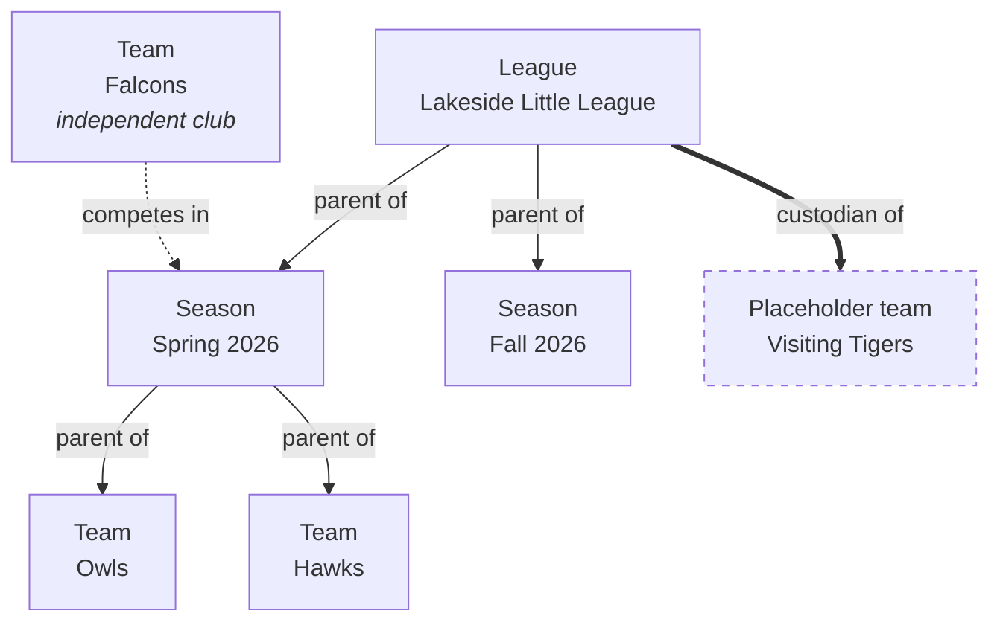
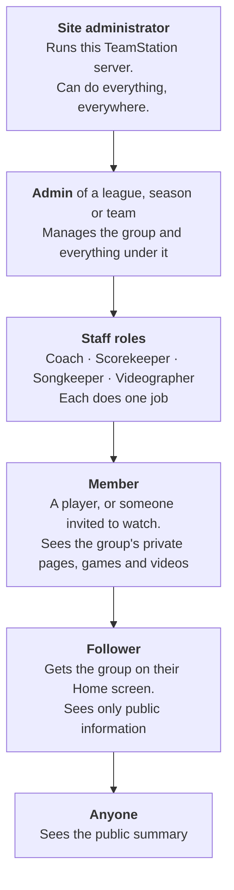
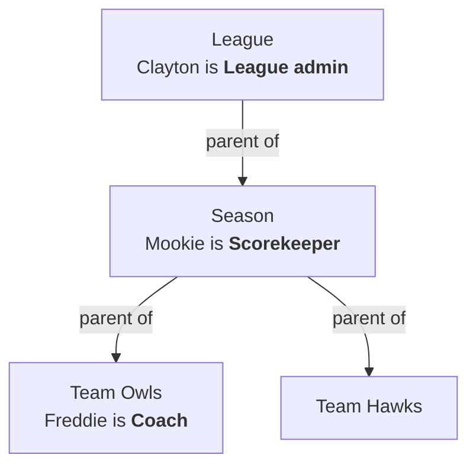
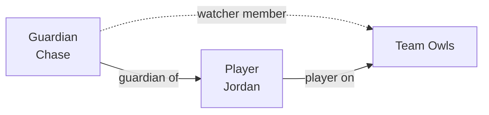
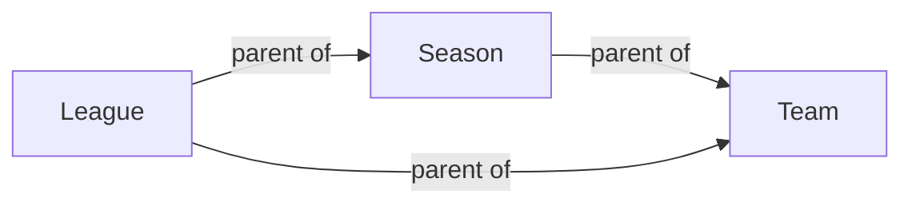
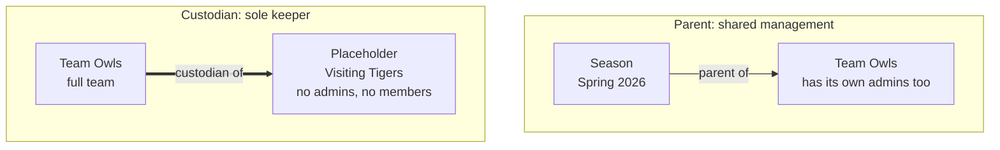
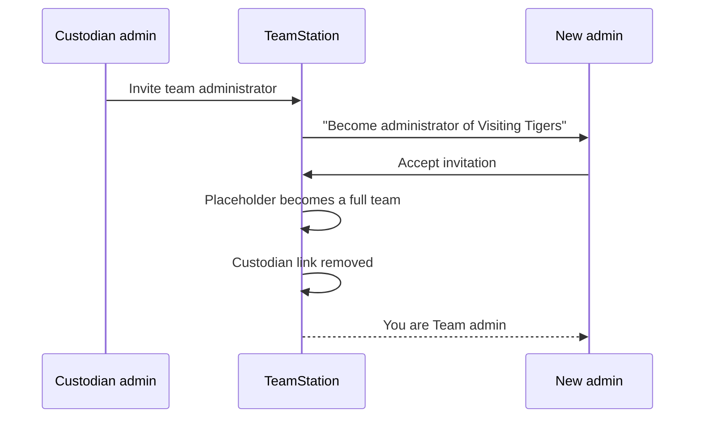
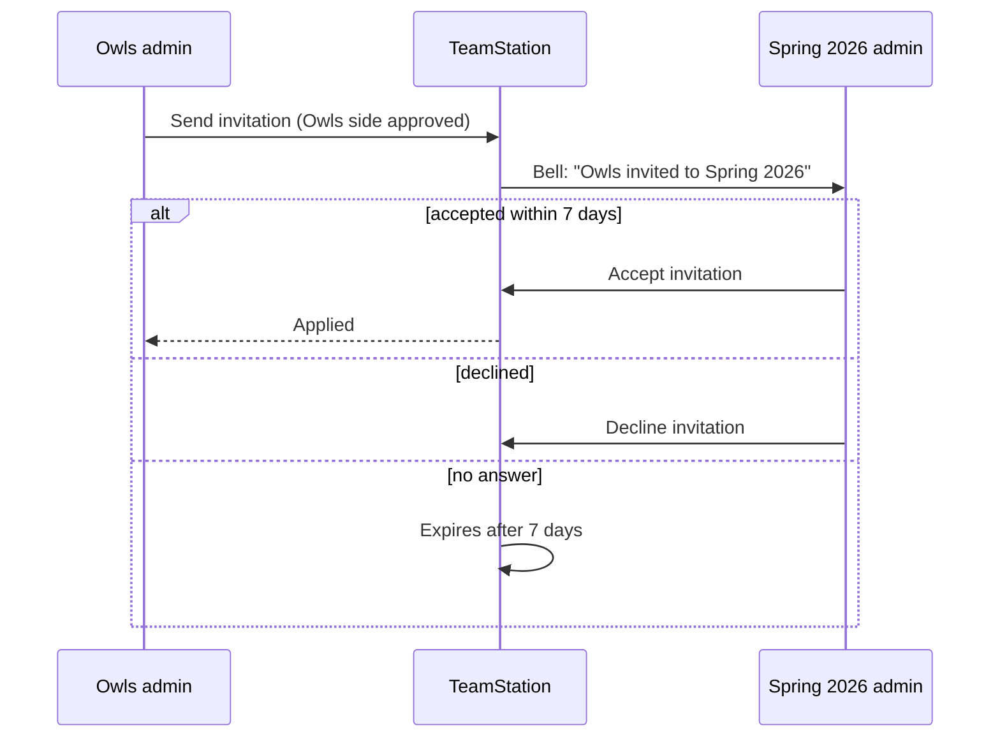

# Who can do what in TeamStation

This guide explains how access works in TeamStation:

- the kinds of groups and how they connect
- the people in them and what each person may do
- the difference between a group's **parent** and a placeholder team's **custodian**

It describes what the app does today. The last section, [Notes for developers](#notes-for-developers), lists the gaps between the code and its stated intent.

**Contents**

1. [Leagues, seasons and teams](#1-leagues-seasons-and-teams)
2. [The access ladder](#2-the-access-ladder)
3. [Admins and the four staff roles](#3-admins-and-the-four-staff-roles)
4. [Members: players and watchers](#4-members-players-and-watchers)
5. [Guardians](#5-guardians)
6. [Following](#6-following)
7. [Parents: sharing management](#7-parents-sharing-management)
8. [Competing in a season is not having a parent](#8-competing-in-a-season-is-not-having-a-parent)
9. [Placeholder teams and their custodians](#9-placeholder-teams-and-their-custodians)
10. [Invitations and approvals](#10-invitations-and-approvals)
11. [Who approves a game](#11-who-approves-a-game)
12. [Safety rules](#12-safety-rules)
13. [Words that mean two things](#13-words-that-mean-two-things)
14. [Quick answers](#14-quick-answers)
15. [Notes for developers](#notes-for-developers)

---

## 1. Leagues, seasons and teams

TeamStation has three kinds of **group**:

| Group | What it is | Example |
| --- | --- | --- |
| **League** | An organization that runs seasons year after year. | Lakeside Little League |
| **Season** | One competition with dates, a schedule and standings. | Lakeside Spring 2026 |
| **Team** | The people who play together. | Owls |

Any group can stand alone. A team can exist without a season, and a season without a league. Groups connect in two ways that sound alike but do very different things:

- **Parent:** the parent's admins also manage the child. This is about **who is in charge**.
- **Competes in:** the team plays in the season's schedule and standings. This is about **who plays whom**, and gives no one any management rights.

A third kind of team, the **placeholder team**, has no admins of its own. It is kept by a **custodian** (see [section 9](#9-placeholder-teams-and-their-custodians)).

In this picture:

- The league's admins manage both seasons, the Owls and the Hawks.
- The Falcons play in Spring 2026 but keep their own management.
- The Visiting Tigers have no admins of their own. The league keeps them.

---

## 2. The access ladder

From most access to least:

What each level can do. Higher levels can do everything below them.

| | Site admin | Admin | Coach | Scorekeeper | Songkeeper | Videographer | Member | Follower | Anyone |
| --- | :-: | :-: | :-: | :-: | :-: | :-: | :-: | :-: | :-: |
| See the public summary: location, staff, schedule, results | ✓ | ✓ | ✓ | ✓ | ✓ | ✓ | ✓ | ✓ | ✓ |
| Have the group on their Home screen | ✓ | ✓ | ✓ | ✓ | ✓ | ✓ | ✓ | ✓ | |
| See private games, videos and stats | ✓ | ✓ | ✓ | ✓ | ✓ | ✓ | ✓ | | |
| Edit players' jerseys, positions, bats and throws | ✓ | ✓ | ✓ | | | | | | |
| See players' full names | ✓ | ✓ | ✓ | ✓ | ✓ | ✓ | | | |
| Score games | ✓ | ✓ | | ✓ | | | | | |
| Set walk-up songs and DJ a game | ✓ | ✓ | | | ✓ | | | | |
| Film and stream games | ✓ | ✓ | | | | ✓ | | | |
| Invite and remove people, change their roles | ✓ | ✓ | | | | | | | |
| Create seasons, teams, placeholder teams | ✓ | ✓ | | | | | | | |
| Schedule and approve games | ✓ | ✓ | | | | | | | |
| Add or break parent links | ✓ | ✓ | | | | | | | |
| Manage site admins, suspend accounts | ✓ | | | | | | | | |

Notes on the table:

- **Full names.** Everyone else sees a short name such as "Mookie B". The full name is visible to:
  - site admins
  - staff (anyone holding a role) on a team the player plays for
  - the player's guardians
  - the player themselves
- **Season and league members** see games only. A member of a season or league sees every game in it, but not the private team pages or player profiles. See [section 4](#4-members-players-and-watchers).
- **Staff hold roles, not membership.** Holding any role on a team lets you see that team as a member would.

---

## 3. Admins and the four staff roles

### Admin

An **admin** ("Team admin", "Season admin", "League admin" in the app) can:

- invite people to the group and remove them
- change what everybody in the group is
- create things inside the group
- schedule and approve games
- link the group to a parent, or unlink it

An admin also holds all four staff roles automatically. In the Roles screen, the role switches are locked on with the caption **"Admins can do all of this"**.

Whoever creates a group becomes its first admin.

### The four staff roles

Each role does one job. An admin can give any combination of them to anyone.

| Role | What it lets you do (app wording) |
| --- | --- |
| **Coach** | "Edits the players' jerseys, positions, bats and throws, and sees their full names." |
| **Scorekeeper** | "Scores the games." |
| **Songkeeper** | "Sets walk-up songs and DJs the games." |
| **Videographer** | "Films and streams the games." |

A role is **not** admin. A coach can't invite people or change anyone's role.

### Roles flow downhill

A role given at one level applies to everything **under** it through parent links, never above it:

- a league admin is an admin of every season and team in the league
- a season's scorekeeper can score games for every team the season is parent of

| | League | Season | Owls | Hawks |
| --- | :-: | :-: | :-: | :-: |
| Clayton, League admin | admin | admin | admin | admin |
| Mookie, Scorekeeper on the season | — | scorekeeper | scorekeeper | scorekeeper |
| Freddie, Coach on the Owls | — | — | coach | — |

On the Roles screen, inherited roles show as locked switches labelled **"From ‹group›"**. To take one away, change it at the level it came from.

### Where to manage people

| Group | How to open it |
| --- | --- |
| League | The **People** tab, visible only to admins |
| Season | The **People** tab, or the gear |
| Team | Gear → **Manage people and roles** |

The **Who can watch** table has one tick column per level: Team, Season and League. More than one tick is normal: "a coach whose child is on the roster is in the team and the season."

---

## 4. Members: players and watchers

A **member** can see a group's private content but has no management role.

### Team members

A team member is one of three things:

| Kind | How they got here | Shows on the roster under |
| --- | --- | --- |
| **Owner / manager** | Created the team, or was made its admin | **Coaches** |
| **Player** | Added as a player | **Players** |
| **Watcher** | Accepted an invite to watch, or is a player's guardian | **Followers** |

The roster's headings don't match the role names. Its **Coaches** heading lists the team's admins (owners and managers), not people with the Coach role. Its **Followers** heading lists watch-only *members*, not people who pressed **Follow**. See [section 13](#13-words-that-mean-two-things).

A team member sees:

- the team's private page and roster (short names only)
- its games, videos, plays and stats
- the profiles of people who have played for the team

### Season and league members

You can belong to a season or a league without being on any team. This is for people like a league photographer or a grandparent who wants every game.

- A **season member** sees every game of that season.
- A **league member** sees every game of every season in the league, including seasons created later.
- Neither one sees team pages or player profiles. Their access covers games only.

### How people become members

- **Invite by email.** An admin uses **Add somebody**, optionally with roles. "Invitations last seven days." Nothing is granted until the person accepts.
- **Invite link.** An admin uses **Invite people**: "Anybody with the link can watch…". A link only ever grants watching, and never lowers access someone already has.
- **Added as a player** by a team admin.

There is no "ask to join" button. Joining always starts with an admin.

---

## 5. Guardians

A **guardian** is an adult linked to a specific player, usually a parent. The link is between two *people*, not between a person and a team.

A guardian can:

- see the child's full name, even if the guardian holds no role on the team
- see the child's team as a member, because adding a guardian also adds them to the team as a watcher

A guardian can't:

- edit the child's jersey, position, bats or throws (Coach or admin only)
- set the child's walk-up song (Songkeeper or admin only)
- see anything a member can't see

Guardians are added together with the players, when a team admin's roster tool imports adults through the API. The app has no screen for adding a guardian by hand yet.

---

## 6. Following

**Follow** is a bookmark, not a permission. Anyone signed in can follow any league, season or team. The group then appears on their Home screen after their own groups.

- Following gives **no access**. A follower sees the same public summary as anyone else.
- The **Follow / Following** button appears only to people who see the public view. Members don't need it, because their groups are already on Home.

---

## 7. Parents: sharing management

A **parent link** says "this group's admins and staff also run that group." It is the only way roles flow from one group to another.

### Which links are allowed

| Child | Possible parents | How many |
| --- | --- | --- |
| League | — | A league never has a parent. |
| Season | A league | At most **one**. To move a season, break the old link first. |
| Team | A league and/or seasons | At most **one league**. Any number of seasons, as long as they're **all in that league** (for example, a Regular Season and its Playoffs). A team with no league can have only one parent season. |
| Placeholder team | — | Never has a parent. It has a custodian instead ([section 9](#9-placeholder-teams-and-their-custodians)). |

A team can never be a parent, so links can't form a loop.

### What a parent link changes

- **Adding** a link immediately gives the parent's admins and staff the same roles on the child.
- **Breaking** a link immediately takes those inherited roles away. Roles given directly on the child stay.
- A parent link **never touches** rosters, games, results or which seasons a team competes in. The app says: "Only management permissions change. Competition memberships, rosters, games and results are preserved."

A few links follow automatically:

- **Season joins a league.** Its teams that had no league join that league too.
- **Team gets a parent season.** If the team has no league, it takes the season's league.
- **Season leaves its league.** The season stops being parent of those of its teams that have a league. The teams keep their league.
- **Team leaves its league.** The team also loses its parent seasons in that league.

The app shows every one of these in a preview before anything is saved.

### Who must agree

| Action | Who must approve |
| --- | --- |
| **Add** a parent link | An admin of the **child** *and* an admin of the **parent** |
| **Break** a parent link | An admin of **either** side. It happens at once, with no invitation. |
| **Create** a group under a parent | You must already be an admin of the parent. The link is made on creation. |

When the same person administers both sides, they can approve for both at once: **"I approve for all affected groups"**. Otherwise the request goes to the other side's admins ([section 10](#10-invitations-and-approvals)).

---

## 8. Competing in a season is not having a parent

A team **competes in** a season when it is on that season's schedule and standings. This is called *participation*, or *competition membership*. It is completely separate from management.

|  | **Season is the team's parent** | **Team competes in the season** |
| --- | --- | --- |
| In the app | "Team this season manages" | "Team that competes" |
| Season admins manage the team? | **Yes** | **No.** "The team plays in this season and keeps its own management." |
| Season staff roles reach the team? | Yes | No |
| Season members see the team's private pages? | No. Season members see games only. | No |
| Team appears in the season's Teams tab and standings? | Yes, once it has games | Yes |
| Who must agree | Admins of both | Admins of both |
| How to end it | **Break parent relationship** (either side) | **End participation** (either side). Games are kept. |

The two are independent. A team can have a parent season and also compete in it, or compete in a season it has no parent link to (the Falcons in [section 1](#1-leagues-seasons-and-teams)).

On the season's Teams tab, teams are grouped by their games, not by their links. **Exhibition** is a property of a game, not of a team. The groups are:

- **Teams:** has a regular game in the season
- **Exhibition Teams:** has exhibition games only
- **Unscheduled:** "These teams are in the season but don't have scheduled games."

---

## 9. Placeholder teams and their custodians

A **placeholder team** is a stand-in for a team that isn't on TeamStation. A typical use is an out-of-town opponent, so their games can be scheduled and scored. It has no admins and no members of its own. Instead, it has exactly one **custodian**: the league, season or team that keeps it. The app shows **"Managed by ‹custodian›"**.

In the app: "A stand-in for a team without its own administrator, kept by ‹name›."

### What the custodian's admins can do

- create the placeholder, from the league or season **Create** sheet, the team's settings, or while setting up a game
- schedule its games, and approve or decline game proposals on its behalf
- invite one real person to take it over (promotion, below)

### What nobody can do while it's a placeholder

- invite members or give anyone roles on it
- join it to a season as a competing team
- give it a parent link

### Custodian vs parent

| | **Parent** | **Custodian** |
| --- | --- | --- |
| Applies to | Seasons and full teams | Placeholder teams only |
| How many | One league, plus seasons in that league | Exactly one |
| Can be a league? | Yes | Yes |
| Can be a season? | Yes, of a team | Yes |
| Can be a team? | **No** | **Yes**, a full team (never another placeholder) |
| The child also has its own admins? | Usually, yes | **Never**. The custodian is the only management. |
| Roles reach the child | Admins *and* staff roles | Admin rights only, for scheduling and approving |
| Rights reach further down? | Yes, keeps flowing downhill | No, a placeholder has nothing under it |
| Needs the child's consent? | Yes, both sides approve | No, the custodian creates it |
| Ends when | Either side breaks the link | The placeholder is promoted |

A league, a season or a full team can each be a custodian. The difference is only whose admins keep the placeholder:

| Custodian | Who keeps the placeholder | Typical use |
| --- | --- | --- |
| **League** | League admins, and anyone who inherits league admin | Opponents the whole league plays |
| **Season** | Season admins, including league admins above it | An opponent in one season's schedule |
| **Team** | That team's admins, including season and league admins above it | A team's own exhibition opponent |

A placeholder can't be the custodian of another placeholder.

### Promotion: when the real team arrives

When the real team arrives, a custodian admin uses **Invite team administrator**. The person invited must have signed in and verified their email. When they accept:

1. The placeholder becomes a full TeamStation team, keeping its name, location and game history.
2. The person who accepted becomes its admin.
3. The custodian link ends, and the custodian's admins lose all rights over it.
4. Games awaiting approval need the new admin's approval again.

---

## 10. Invitations and approvals

Every change that affects more than one group, or that grants someone access, is an **invitation**. Invitations follow the same rules:

- **Two-way.** Every affected side must approve. Sending counts as your side's approval.
- **Any eligible admin can answer** for their team, season or league. "Opening this invitation does not approve it."
- **Seven days.** An invitation expires if it isn't answered. The sender can **withdraw** or **resend** it.
- **Approval is checked again at the end.** If your admin rights came from a parent link that has since been broken, your earlier approval no longer counts.
- **Changing a season's dates or time zone** cancels its pending parent and participation invitations, because they named the old dates.

| Invitation | Sent by | Approved by | When accepted |
| --- | --- | --- | --- |
| **Person** (Add somebody) | Group admin | The invited person | They get the access and roles that were offered |
| **Parent** | Admin of the child or parent | Admins of both | The parent link is made |
| **Participation** (Join a season) | Admin of the team or season | Admins of both | The team competes in the season |
| **Promotion** | Custodian admin | The invited person | The placeholder becomes a full team (see [section 9](#9-placeholder-teams-and-their-custodians)) |
| **Game / game change** | Admin of a playing team, or of the hosting season | Both teams' admins | The game is published or changed (see [section 11](#11-who-approves-a-game)) |

Everything waiting on you is in the bell's inbox:

- **Pending:** waiting on you ("Needs your approval")
- **Sent:** waiting on others ("Awaiting approval")
- **History:** finished invitations

---

## 11. Who approves a game

A game has two sides: the home team and the away team. It is published when **both** sides have approved. For each side, an approval can come from:

- an admin of that team, directly or through a parent link, or
- for a placeholder team, an admin of its custodian.

There is no separate approval from the season. However, placing a new game in a season requires the sender to be an admin of that season.

| You administer… | You see | What happens |
| --- | --- | --- |
| Both teams | **Save** | Published immediately |
| One team | **Send Game Proposal** | The other team's admins must approve. "An admin of ‹team› must approve changes." |
| Only the season | **Send Game Proposal** | Both teams' admins must approve |

Until the game is approved, it shows **Pending approval** where the score would be.

Other game rules:

- **Withdrawing.** Any admin of either team can withdraw their team without approval. The game stays on the schedule as cancelled, with the reason.
- **Changing an opponent you don't administer.** The original game is cancelled, still visible to that opponent, and a new game is proposed.

---

## 12. Safety rules

- **Every group keeps at least one admin.** "Add another active direct administrator before removing the last one." Only admins given directly on the group count; admins inherited from a parent don't. Placeholder teams are the exception, since they never have admins.
- **New admins must be real, verified accounts.** They must have signed in and verified their email.
- **Leaving.** You can remove yourself or step down as admin, as long as another direct admin remains.
- **Removing someone is local.** Removing a person from a group takes away only what they hold *at that level*. Access inherited from a parent stays until it's removed at the level it came from.
- **Site administrators:**
  - Only a site admin can change another site admin.
  - The last site admin can't be removed.
  - Suspending an account is refused if it would leave a group with no admin. Otherwise it signs the person out everywhere and stops their live streams.

---

## 13. Words that mean two things

| You see | It means | It doesn't mean |
| --- | --- | --- |
| **Coaches** heading on a team roster | The team's owners and managers, who are its admins | People given the Coach role |
| **Coach** switch in Roles | The staff role: edits player details, sees full names | Admin |
| **Followers** heading on a team roster | Team *members* who can watch but don't play | People who pressed **Follow** |
| **Follow** button | A bookmark on your Home screen, with no access | Membership |
| **Parent** (of a group) | A league or season that shares management of it | A player's parent. That person is a **guardian**. |
| **Staff and coaches** on a public team page | Anyone holding any role on the team, including inherited ones, shown as first name and last initial | Only coaches |
| **Placeholder team** | A team kept by a custodian, with no admins of its own | An "external" team. The app never uses that word. |

---

## 14. Quick answers

**I'm a league admin. Can I manage a team in my league?**
Yes, if the team's chain of parents leads up to your league. If the team only *competes* in one of your seasons, no.

**Our team joined a season. Can the season's admins now edit our roster?**
No. Competing gives the season no management rights. Only a parent link does, and that needs your team admin's approval.

**Can a team have two seasons as parents?**
Yes, for example a regular season and its playoffs, but both must be in the same league as the team.

**What's the difference between a team with a parent season and a placeholder team kept by a season?**
A team with a parent has its own admins, and the season's admins manage it *alongside* them. A placeholder has no admins of its own: the custodian is its only management, and only until a real admin takes it over.

**Can a team be a custodian? Can it be a parent?**
A full team can be a custodian of placeholder teams. A team can never be a parent.

**My child is on the team. Why can't I change their jersey number?**
That's a coach's job. Guardians see their child's full name, but changing player details takes the Coach role or admin.

**Does following a team let me see its videos?**
No. Following only puts the team on your Home screen. Ask a team admin for an invitation or invite link.

---

## Notes for developers

These are differences between the code on `master` and what the product notes describe. They are listed here so this document stays honest.

- **Multiple parent seasons.** Earlier notes say "a team can have one parent season." The code allows several, provided they all share the team's league (`src/server/groups/relationships.ts`, `validate`).
- **`spectator_access`** on `leagues` and `seasons` is stored but not read by anything. It was once "everyone on any team in the season sees all its games." Tests now check that it grants nothing.
- **Guardians:**
  - `user_links.can_manage` is written but never read.
  - The `family` kind is read but never written.
  - `other` is unused.
  - Guardians can only be created through `POST /teams/:teamId/adults`.
  - `GET /players/:userId/name` returns `canEditName`, but no route edits another person's name.
- **`memberships.is_spectator`** and **`memberships.granted_by_link_id`** have no effect on access.
- **`season_members.role` / `league_members.role` = `member`** is allowed by the schema but never written. Only `spectator` is.
- **"%s has been added."** is never shown, because adding a person always sends an invitation.
- **Roster headings.** The roster's "Coaches" group is membership owner/manager, not the `coach` role flag. Its "Followers" group is watch-only members, not the `follows` table. Renaming them, for example to "Admins" and "Watching", would remove the two most confusing collisions in [section 13](#13-words-that-mean-two-things).

Where the rules live in code:

| Topic | Files |
| --- | --- |
| Roles and inheritance | `src/common/roles.ts`, `src/server/access.ts` |
| Who administers a group, including custodians | `src/server/groups/rights.ts` |
| Parent links | `src/common/groupLinks.ts`, `src/server/groups/relationships.ts` |
| Invitations | `src/server/groups/requests.ts` |
| Last-admin guard | `src/server/groups/adminGuard.ts` |
| Game approvals | `src/server/schedule/gameApprovals.ts` |
| People management | `src/server/routes/manage.ts`, `src/app/screens/ManageScreen.tsx`, `RolesModal.tsx` |
